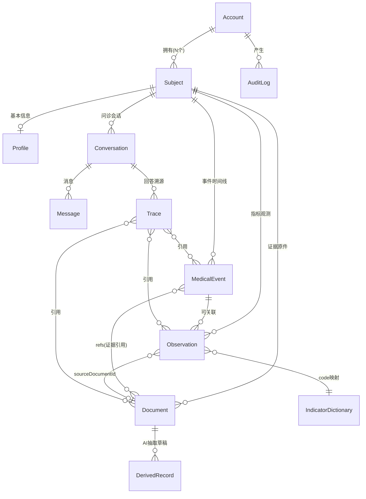
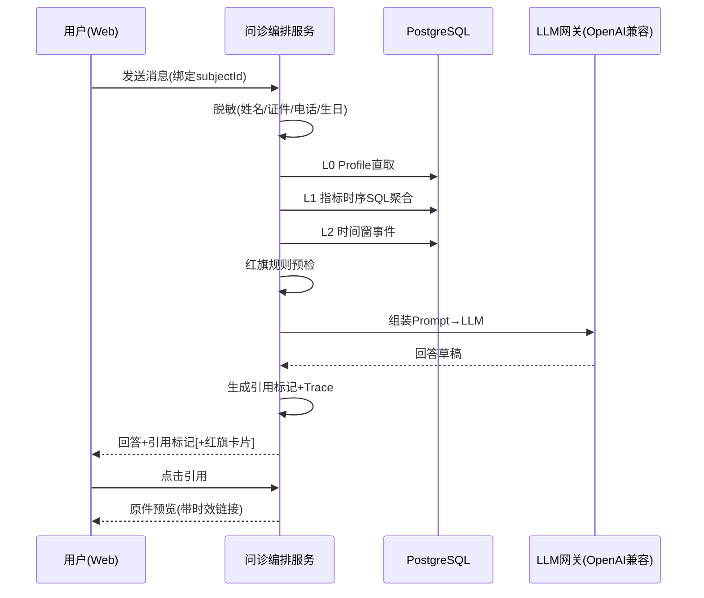

# AI 私人医生系统 — 产品需求文档（PRD）V0.1（P0 初版功能交付）

> 关联文档：《AI私人医生系统-产品方案V0.1.md》（下称"产品方案"）
> 作者：产品经理许清楚（Xu） | P0 基线文档 | 更新：2026-07
> 阅读约定：P0 = MVP 必须交付；P1/P2 = 后续版本（本 PRD 只列边界与留缝，不展开 AC）
> **2026-10-26 导航**：本文描述 P0 基线，不等于当前完整实现或下一阶段范围。最新实现/评测状态只看 `PLAN.md` §0；长期健康资产与主动取证问诊的新需求、AC 目标及排期见 `docs/superpowers/specs/2026-10-26-health-record-intelligence.md` 和同名实施计划。新设计评审后再将其 AC 合并为正式 PRD 新版本。

---

## 0. 下一阶段产品决策摘要（2026-10-26，待评审）

以下是对新方向的产品约束摘要，详细验收口径以新设计为准，**不是已完成能力**：

1. 核心资产从“检查报告”扩展为检查/检验、病历、体检、出院小结、治疗、用药、影像、心电和文本记录；原件与派生副本同等可查询。
2. 文字型记录形成保真、版本化 Markdown；检查单形成标准指标；影像/心电形成报告结论和原件引用，不强行全文图像化。
3. 以发生时间和临床问题组织长期记录；提供全文+语义+结构化混合检索与大量记录分页/筛选。
4. AI 按急性/慢病任务主动调档，必要时读指定原件页/图和检索有版本的外部医学证据；缺关键症状时少问、问关键，证据足够时给有依据的倾向性判断。
5. 延续 Subject 隔离、HITL、原件证据、引用、审计、脱敏和红旗边界。免责声明不替代医疗安全评测，“敢于判断”不等于无依据确诊或自动开方。
6. 默认“删除=归档，可恢复”；永久删除须另做合规、引用影响、对象存储与备份删除设计。
7. 新发布门槛增加关键证据召回、采用证据精确率、时间正确性、追问质量、论断支持率和大规模性能；不得仅凭向量已接入或模型演示宣称达标。

---

## 1. 产品背景 / Problem / Goal / Non-goals

### 1.1 背景
- 家庭健康资料（化验单、病历、体检报告、用药记录）以照片/PDF 散落，随时间丢失，无法回答"同一指标这几年怎么变的"。
- 老人/小孩不会（也不需要）自己用 App；实际维护者是家庭中的一个管理员。
- 通用 AI 聊天不懂"我的档案"，且无法给出可核对的依据，医疗场景不可信。

### 1.2 Problem（要解决的问题）
| # | 问题 | 现状痛点 |
|---|---|---|
| P-1 | 健康资料无结构、无时间线 | 文件堆，无法做时序对比 |
| P-2 | AI 问诊无证据、易幻觉 | 通用聊天不读档案、引用不可回链 |
| P-3 | 一人管多人档案易串档 | 现有工具多为"一人一账号" |
| P-4 | 报告数据录入成本高 | 手抄指标易错、难持续 |

### 1.3 Goal（P0 目标）
- G1：打通"上传报告 → AI 抽取 → 人工确认 → 结构化入库 → 时间线/趋势呈现"闭环。
- G2：打通"对话问诊 → 分层上下文组装 → 带引用回答 → 点击回链原件"闭环。
- G3：一个 Account 管理多个 Subject（家庭成员），**零串档**。
- G4：架构可持续演进（P1/P2：DICOM、L3 向量层、多客户端、本地模型），容器化可编排部署。

### 1.4 Non-goals（P0 明确不做）
- ❌ DICOM 影像链路（Orthanc/OHIF）、语音问诊、医学知识图谱/遗传分析
- ❌ 小程序 / iOS / Android 客户端（P0 仅 Web 单页应用）
- ❌ 生成处方、宣称诊断结论（产品定位为"健康参考与就医建议"）
- ❌ 全家共享多账号协作（P0 仅单 Account 内多 Subject）
- ❌ 医学知识库 RAG（P2）、微调本地医疗模型（P2）

---

## 2. 用户与角色

| 角色 | 说明 | 典型场景 |
|---|---|---|
| **家庭管理员（主用户）** | 注册 Account 的人，如中年子女 | 上传父母体检报告、确认抽取结果、替父母问诊"我妈血糖最近怎么样" |
| **档案主体 Subject** | 被照护对象：本人/老人/孩子，**不需要登录** | 被动的数据主体，所有数据挂在其档案下 |
| **AI 问诊助手（系统角色）** | 基于 Subject 档案做时序推理 | 回答必须带引用、依据不足须声明、红旗强制转诊 |
| **首次使用者（本人档）** | 只管理自己健康档案的用户 | 同一入口，默认 Subject=本人 |

> 核心设计：**Subject 与 Account 分离**——一个 Account 挂 N 个 Subject；老人/孩子无需会用手机。

---

## 3. 业务 KPI 与 P0 成功判据（Go/No-Go）

沿用产品方案 §四 Go/No-Go 门槛，作为 P0→P1 投入条件：

| # | 指标 | 阈值 | 测量方式 |
|---|---|---|---|
| K1 | 常见化验单抽取字段准确率（数值+单位+日期） | **≥ 90%** | 自家真实样本 **30+ 张**，人工比对 |
| K2 | 异常指标召回率 | **≥ 95%** | 同上样本集，标注异常项是否被抽出 |
| K3 | 典型时序问题引用正确率 | **≥ 85%** | **20 个**典型问题人工评测（引用的数据/时间/人是否正确） |
| K4 | 跨人串档事故 | **0**（零容忍） | 全量写入审计日志抽查 + 专项测试 |
| K5 | 预处理闭环完成率 | ≥ 80% 的上传可走完"上传→确认→入库" | 埋点：Document 状态机终态统计 |

**No-Go 规则**：K1–K4 任一不达标 → 不扩功能，先修预处理流水线与指标字典。

---

## 4. Scope：In / Out

### 4.1 In（P0 范围）

| 模块 | P0 内容 |
|---|---|
| 账户与档案 | 注册/登录（JWT）、Account 下多 Subject、档案切换器、**写入强制选档** |
| 资料上传 | 图片/PDF 上传、分类分流、OCR/VLM 抽取、指标字典映射、HITL 确认入库 |
| 档案呈现 | MedicalEvent/Observation 时间线、TOP20 指标趋势折线（含参考区间带）、原件回看 |
| 对话问诊 | OpenAI 兼容 API、L0–L2 上下文组装、引用标记与原件回链、红旗规则、对话式添加档案 |
| 安全基础 | JWT 鉴权、审计日志、LLM 调用前脱敏 |
| 交付形态 | 后端容器化（Docker + Compose/K8s 友好）、Web 单页应用 |

### 4.2 Out（非 P0，含版本规划）

| 版本 | 内容 |
|---|---|
| P1 | DICOM 影像链路（Orthanc+OHIF 或降级 VLM 初读）、L3 向量语义检索全量启用、医生版 PDF 摘要导出、用药/随访提醒、小程序壳 |
| P2 | 家庭关系图谱与遗传风险、指标字典社区化/联网对齐、医学知识库 RAG、本地医疗模型微调评测线 |
| 暂无排期 | 语音问诊、多 Account 协作共享、App 原生端 |

---

## 5. 产品对象模型

### 5.1 Mermaid ER 图



### 5.2 对象要点（关键字段与设计决策）

| 对象 | 关键字段 | 设计要点 |
|---|---|---|
| Account | id, email/phone, passwordHash, createdAt | 登录主体，≠档案主体 |
| Subject | id, accountId, name, relation, avatar, isDefault | 被照护对象；一人管多人 |
| Profile | 生日、性别、血型、过敏史、家族史 | L0 静态上下文来源 |
| MedicalEvent | type, **occurredAt + recordedAt**, narrative, diagnosis, refs[] | **双时间轴**；病历=事件流非文档堆 |
| Observation | code, value, unit, refRange, occurredAt, abnormalFlag, sourceDocumentId | 结构化时序，趋势用 SQL 确定性计算 |
| Document | kind(PDF/图片/…), fileKey, status(状态机) | **永不删除**的证据层 |
| DerivedRecord | 抽取草稿 + 每项置信度 + 原文位置 | HITL 确认前的中间态 |
| Conversation | subjectId(唯一绑定), messages[] | 会话级绑定 Subject |
| Trace | 回答引用的 Observation/Event/Document ID 列表 | 可溯源、供 Eval |
| IndicatorDictionary | code ↔ 中文名 ↔ 别名 ↔ 单位 ↔ 参考区间(版本化) | 冷启动 TOP50 手工建典 |

### 5.3 可拓展留缝（为 P1/P2）

| 演进方向 | P0 留缝设计 |
|---|---|
| DICOM（P1） | Document.kind 枚举预留 `DICOM`；存储走 MinIO，元数据表可扩展 modality 字段 |
| L3 向量层（P1） | PostgreSQL 开启 pgvector 扩展；叙述文本入 `embedding` 列的表结构先定义、P0 可不填充 |
| 多客户端（P1/P2） | 全部能力经统一 REST + OpenAI 兼容 chat 协议暴露，客户端不持 LLM key |
| 本地模型（P1） | LLM 接入层为 OpenAI 兼容网关抽象，切换 base_url 即可接 Ollama/NewAPI |
| FHIR 对外（P2） | 内部对象语义按 FHIR R4（Observation/DocumentReference 等）设计，不实现完整 FHIR Server |

---

## 6. 信息架构与功能清单

### 6.1 信息架构（Web SPA）

```
/ 登录·注册
└─ /app 主应用（顶部常驻：Subject 选择器大 chip + 免责声明）
   ├─ 时间线 Timeline        事件流 + TOP 指标趋势折线切换
   ├─ 档案 Archive           文档列表 / 待确认抽取任务 / 原件回看
   │    └─ /archive/:id      文档详情：原件预览 + DerivedRecord 确认卡片
   ├─ 问诊 Chat              会话列表 + 对话区（引用标记、图表、红旗提示）
   │    └─ /chat/:conversationId
   ├─ 成员 Subjects          增删家庭成员、档案概览
   └─ 设置 Settings          账户安全、脱敏开关、审计日志查看、免责声明
```

### 6.2 功能清单（P0/P1/P2 分级）

| ID | 功能 | 优先级 | 所属模块 |
|---|---|---|---|
| F-01 | 注册/登录（JWT） | **P0** | 账户 |
| F-02 | 多 Subject 管理与切换器（记忆上次选择） | **P0** | 档案 |
| F-03 | 写入强制选档（无 subjectId 阻断） | **P0** | 档案 |
| F-04 | 图片/PDF 上传 + 分类分流 | **P0** | 预处理 |
| F-05 | OCR/VLM 抽取 + 指标字典映射 → DerivedRecord | **P0** | 预处理 |
| F-06 | HITL 确认/修正入库（低置信强制确认） | **P0** | 预处理 |
| F-07 | 时间线视图（MedicalEvent 流） | **P0** | 档案 |
| F-08 | TOP20 指标趋势折线（参考区间带） | **P0** | 档案 |
| F-09 | 对话问诊（L0–L2 上下文组装） | **P0** | 问诊 |
| F-10 | 引用标记 + 点击回链原件（L4） | **P0** | 问诊 |
| F-11 | 红旗规则引擎（强制转诊提示） | **P0** | 问诊 |
| F-12 | 对话式添加档案（确认卡片入库） | **P0** | 问诊 |
| F-13 | 原件回看（PDF/图片预览） | **P0** | 档案 |
| F-14 | 审计日志 + LLM 脱敏管线 | **P0** | 安全 |
| F-15 | 容器化部署（Compose/K8s 友好） | **P0** | 运维 |
| F-16 | L3 向量语义检索全量 | P1 | 问诊 |
| F-17 | DICOM 影像链路 | P1 | 档案 |
| F-18 | 医生版 PDF 摘要导出 | P1 | 档案 |
| F-19 | 用药/随访提醒 | P1 | 问诊 |
| F-20 | 家庭关系图谱/遗传风险 | P2 | 档案 |

### 6.3 P0 用户故事与验收标准（AC 可测试）

#### F-01 注册/登录
- **US**：作为家庭管理员，我要注册并登录，以便进入我的健康档案空间。
- **AC**：
  1. AC-1.1 新邮箱注册成功后自动登录并创建默认 Subject（本人）；
  2. AC-1.2 错误密码登录返回 401 且不泄露账号是否存在；
  3. AC-1.3 登录后所有受保护 API 携带过期 JWT 请求返回 401。

#### F-02 多 Subject 管理与切换
- **US**：作为管理员，我要在顶部切换器中管理并切换父亲/母亲/孩子/本人档案。
- **AC**：
  1. AC-2.1 可新建 Subject（姓名、关系、生日、性别），列表即时刷新；
  2. AC-2.2 切换档案后，时间线/文档/会话入口均只显示该 Subject 数据；
  3. AC-2.3 重新登录后默认回到上次选中的 Subject；
  4. AC-2.4 界面常驻显示当前 Subject 名称（含头像/颜色标识）。

#### F-03 写入强制选档
- **US**：作为管理员，我绝不会把数据写错到别人档案。
- **AC**：
  1. AC-3.1 未选中 Subject 时，上传、对话添加、确认入库按钮均禁用并提示"请先选择档案对象"；
  2. AC-3.2 API 层对无 subjectId 的写请求返回 422/400，不落库；
  3. AC-3.3 集成测试：任意写路径在缺 subjectId 时数据库无新增行（**对应 K4 零串档**）。

#### F-04 上传 + 分类分流
- **US**：作为管理员，我要上传化验单照片或 PDF，系统自动判断文档类型。
- **AC**：
  1. AC-4.1 支持 JPG/PNG/PDF 单文件 ≤20MB，上传后生成 Document 记录（status=待处理）；
  2. AC-4.2 分类器输出 docType（化验单/影像报告/病历/其他）并进入对应解析分支；
  3. AC-4.3 重复文件（同 subject 同内容 hash）提示"已存在相同文件"，可选择仍要上传。

#### F-05 抽取 + 指标字典映射
- **US**：作为管理员，系统要把报告里的指标自动抽成结构化草稿，我只需确认。
- **AC**：
  1. AC-5.1 抽取产出 DerivedRecord：每项含字段值、置信度、原文位置；
  2. AC-5.2 命中指标字典的项展示标准中文名+单位，未命中标记"字典未命中"入反馈队列；
  3. AC-5.3 发生日期抽取优先取"报告内检查日期"，与上传日期区分（双时间轴）；
  4. AC-5.4 抽取失败（status=解析失败）给出原因并允许重试或手动录入。

#### F-06 HITL 确认入库
- **US**：作为管理员，低置信和异常项我必须亲自确认，高置信可快速通过。
- **AC**：
  1. AC-6.1 置信度 < 阈值（默认 0.85）或数值异常的字段高亮为必确认，未确认不可整体入库；
  2. AC-6.2 确认/修改后生成 MedicalEvent + Observation，Document status→已确认，且保存修改前后值（审计）；
  3. AC-6.3 拒绝的字段不入库；全部拒绝则 Document status→已解析但无事件；
  4. AC-6.4 同一 Document 不可重复入库产生重复事件（幂等）。

#### F-07 时间线视图
- **US**：作为管理员，我要按时间看到母亲的就诊、体检、用药事件。
- **AC**：
  1. AC-7.1 时间线按 occurredAt 倒序分组（年/月），显示类型、标题、关联文档角标；
  2. AC-7.2 筛选：事件类型、时间范围；
  3. AC-7.3 空档案显示引导上传，不显示空白报错。

#### F-08 TOP20 指标趋势折线
- **US**：作为管理员，我要看血糖/血压等指标近 N 次的折线趋势。
- **AC**：
  1. AC-8.1 选择指标后折线图由 SQL 聚合生成（数据确定性，非模型生成）；
  2. AC-8.2 图表含参考区间背景带、单位、occurredAt 横轴；
  3. AC-8.3 某指标仅 1 条数据时显示"数据不足成线"提示。

#### F-09 对话问诊（L0–L2 上下文）
- **US**：作为管理员，我要就当前选中 Subject 的档案提问，得到有依据的回答。
- **AC**：
  1. AC-9.1 会话创建时绑定当前 subjectId，会话内不可变更；切换 Subject 后新建会话或弹确认"将切换到 XX 的档案"；
  2. AC-9.2 回答请求组装 L0（Profile）+ L1（相关指标 SQL 序列）+ L2（相关事件）；
  3. AC-9.3 会话历史只读取本 subject 的 Message，跨 Subject 数据不出现在回答中（**K4**）；
  4. AC-9.4 LLM 超时/网关错误返回友好错误并可重试，不产生半截 Trace。

#### F-10 引用标记 + 原件回链
- **US**：作为管理员，我要核对 AI 每个结论依据的原始报告。
- **AC**：
  1. AC-10.1 回答中依据以引用标记呈现，如 `[依据：2026-03-12 血常规报告]`；
  2. AC-10.2 点击引用打开对应 Document 原件预览（带时效内部链接）；
  3. AC-10.3 每次回答生成 Trace，记录引用的 Observation/Event/Document ID，可在"查看依据"面板展开；
  4. AC-10.4 无档案依据的问题不出现引用标记，且触发 F-10a 依据不足声明。

#### F-10a 依据不足声明（见 §8）
- **AC**：档案数据不足时回答必须包含"依据有限"声明句，检测用例库通过率 100%。

#### F-11 红旗规则
- **US**：作为管理员，遇到危险症状时系统必须明确提示立即就医。
- **AC**：
  1. AC-11.1 红旗词/规则表命中（如胸痛放射痛、突发偏瘫、儿童高热惊厥）时，强制在回答顶部插入"立即就医"提示卡片，**由规则引擎插入、非模型决定**；
  2. AC-11.2 红旗命中事件写入审计日志；
  3. AC-11.3 规则表可配置热更新，不需发版。

#### F-12 对话式添加档案
- **US**：作为管理员，我说"我爸今天说头晕，血压 150/95"，系统直接生成待确认记录。
- **AC**：
  1. AC-12.1 LLM 抽取生成 MedicalEvent+Observation **草稿卡片**，展示在对话流中，含 Subject 头像；
  2. AC-12.2 点击"确认入库"才写库；编辑后入库以编辑值为准；
  3. AC-12.3 未确认的草稿不进入时间线；会话删除草稿不产生孤儿数据；
  4. AC-12.4 recordedAt=当前时间，occurredAt 取消息中的时间表达（如"今天"解析为当日）。

#### F-13 原件回看
- **AC**：
  1. AC-13.1 文档详情页可预览图片/PDF 原件；
  2. AC-13.2 从时间线事件、Observation、引用标记均可跳转到原件；
  3. AC-13.3 原件下载/预览链接带过期时间，过期返回 403。

#### F-14 审计日志 + LLM 脱敏
- **AC**：
  1. AC-14.1 写操作（创建/修改/删除/确认入库）记录 who/when/what/前值后值；
  2. AC-14.2 调用云端 LLM 前，姓名、证件号、电话、精确出生日期替换为占位符（保留年龄段）；
  3. AC-14.3 抓包/日志抽查：出域请求体中不含明文姓名与证件号；
  4. AC-14.4 设置页可查看本人操作审计。

#### F-15 容器化部署
- **AC**：
  1. AC-15.1 `docker compose up` 一条命令拉起全栈（api/worker/web/postgres/redis/minio），数据卷持久化；
  2. AC-15.2 所有服务具备 healthcheck，编排文件含依赖顺序与重启策略；
  3. AC-15.3 全部配置经环境变量注入，镜像内无硬编码密钥；
  4. AC-15.4 提供 K8s 清单（Deployment/Service/ConfigMap/Secret/PVC）或 Helm 结构，可在 K8s 集群部署通过。

---

## 7. 关键用户流程

### 7.1 注册登录
```
打开 / → 注册(邮箱+密码) → 创建默认Subject(本人) → 进入 /app → 顶栏显示"当前档案：本人"
登录 → JWT 存储( HttpOnly Cookie / local storage 按安全评审定) → 恢复上次 Subject
```

### 7.2 切换档案对象
```
点顶部 Subject 大 chip → 下拉列出全部成员(+新建) → 选中"父亲"
→ 全局 subjectId 变更 → 时间线/文档/问诊入口重载为父亲数据
→ 若当前处于问诊会话：弹确认"将切换到 父亲 的档案，当前会话将结束/新建" → 确认后新会话绑定父亲
```

### 7.3 上传报告 → 确认入库
```mermaid
flowchart LR
    A[选择Subject\n(强制)] --> B[上传图片/PDF]
    B --> C{重复检测\nhash}
    C -->|重复| C1[提示已存在]
    C -->|新文件| D[Document\nstatus=待处理]
    D --> E[分类分流]
    E --> F[OCR/VLM抽取\n+字典映射]
    F -->|失败| G[解析失败\n重试/手动录入]
    F -->|成功| H[DerivedRecord草稿\n+置信度]
    H --> I[HITL确认页\n低置信/异常必确认]
    I -->|确认/修正| J[写MedicalEvent/Observation\n+建索引+原件归档\nstatus=已确认]
    I -->|拒绝字段| K[不入库\n审计记录]
```

### 7.4 对话问诊 → 引用回链原件


### 7.5 对话式添加信息
```
用户(已选Subject): "我爸今天说头晕，血压 150/95"
→ LLM 抽取 → 对话流内渲染确认卡片(MedicalEvent:自述症状 + Observation:血压150/95)
→ 用户[确认入库] → 写库(recordedAt=now, occurredAt=今天) → 时间线即时可见
→ 用户[编辑后入库] / [丢弃]
```

---

## 8. AI 行为规则

| # | 规则 | 实现要求 | 违反后果/检测 |
|---|---|---|---|
| A-1 | **红旗强制转诊** | 红旗规则引擎（确定性词表+逻辑）命中即强制插入"立即就医"卡片，**不交给模型判断**；规则可配置热更新 | 命中即写审计；红旗 case 测试集通过率 100% |
| A-2 | **依据不足须声明** | 档案内无可支撑数据时必须输出"依据有限/档案中未找到 XX"并引导补充，禁止编造数据 | 依据不足用例库 100% 含声明句 |
| A-3 | **引用必须可回链** | 回答引用的每个 Observation/Event/Document 都必须生成 Trace 并可点击打开原件；**没有 Trace ID 的结论不允许以引用格式呈现** | 无原件 ID 的引用标记数 = 0 |
| A-4 | **LLM 调用脱敏** | 出域前替换姓名→占位符、证件号→掩码、电话→掩码、精确生日→年龄段；本地模型模式可关闭出域 | 抽查出域请求无明文 PII |
| A-5 | **定位边界** | 输出为"健康参考与就医建议"，不生成处方、不宣称诊断；免责声明常驻 | 生成处方类输出拦截+日志 |
| A-6 | **数值计算不交给模型** | 趋势、变化率、聚合由 SQL/代码算出，LLM 只解读结果；图表由数据渲染 | 单测：算术结果与模型文本解耦 |
| A-7 | **会话 Subject 锁定** | 一个会话只属于一个 subjectId，上下文组装只读该 Subject 数据 | 跨档检测测试（K4） |
| A-8 | **对话添加先草稿** | 对话式写入一律先生成草稿卡片，人确认后才入库（HITL） | 未确认草稿不出现在线时间线 |

---

## 9. 业务规则

### 9.1 硬规则

| # | 规则 |
|---|---|
| B-1 | **写入必须选 Subject**：任何 Create/Update 落库接口缺 subjectId → 拒绝（422），前端按钮禁用兜底 |
| B-2 | **双时间轴**：MedicalEvent/Observation 必须同时存 occurredAt（业务发生时间，AI 时序推理唯一依据）与 recordedAt（录入时间）；不得互相覆盖 |
| B-3 | **原件不可删除**：Document 提供归档/隐藏，物理删除仅限合规流程（软删+审计） |
| B-4 | **幂等入库**：同一 DerivedRecord 确认结果不得重复生成相同事件（以 documentId+草稿版本 唯一约束） |
| B-5 | **审计不可绕过**：所有写操作与 AI 抽取确认必须产生 AuditLog |

### 9.2 状态机简表

**Document 状态机**
| 当前态 | 事件 | 次态 |
|---|---|---|
| 待处理(pending) | 分类+解析成功 | 抽取中(extracting) |
| 待处理(pending) | 解析失败 | 解析失败(failed) |
| 抽取中(extracting) | 产出 DerivedRecord | 待确认(awaiting_review) |
| 待确认(awaiting_review) | 用户确认入库 | 已确认(confirmed) |
| 待确认(awaiting_review) | 全部字段拒绝 | 已解析(parsed_no_data) |
| 解析失败(failed) | 用户重试 | 待处理(pending) |
| 已确认(confirmed) | 用户撤回确认(审计留痕) | 待确认(awaiting_review) |

**DerivedRecord 字段级状态**：`proposed → confirmed | corrected | rejected`

**Conversation 状态机**：`active →(切换Subject/用户关闭) archived`

### 9.3 指标字典与标准主数据规则（AI 底座）

**总原则：同一指标在任何医院、任何叫法、任何单位下，系统内必须始终是一个标准指标。**
反复导入同一检查项的别名/单位，绝不允许在趋势里裂成多条线。

#### 9.3.1 标准主数据字段

| 字段 | 说明 |
|---|---|
| `code` | 稳定标识（如 `HGB`）；AI 新建议的指标生成唯一 code，不覆盖既有 |
| `name_cn` | 标准中文名（唯一展示名，如「血红蛋白」） |
| `unit` | 标准单位（如 `g/L`），入库值统一换算到该单位 |
| `category` | 血液/生化/电解质/尿液/血压/其他 |
| `aliases` | 已确认的别名集合（医院写法、英文缩写、OCR 误识），解析时直接命中 |
| `loinc_code` | P2 联网对齐留缝 |

#### 9.3.2 解析时对齐顺序（成本由低到高，能确定就不调 AI）

1. **归一化精确命中**：NFKC → 去标点 → 小写 → 缩写展开（HGB/Hb）→ 等价词（血色素→血红蛋白、比积→压积、空腹血葡萄糖→空腹血糖）→ 命中 `name_cn`/`code`/`aliases`。
2. **模糊命中**：字符相似度 ≥ 0.92 且非易混成对指标（AC-9.4）。
3. **AI 语义对齐**（默认可用）：把「原始名 + 原单位 + 候选词表」交给模型判断是否同一指标。
   - 判定为已有 → 复用其 `code`/标准名/标准单位；
   - 判定为新 → 生成标准名、code、单位、分类与别名，落库为新标准指标（供后续报告复用）；
   - 置信度 < 0.7 或 AI 不可用 → 原文保留 + 进入 `dictionary_misses` 反馈队列。
4. **人工复核**：AI 新建的指标在字典页可编辑标准名/单位/别名；人工修正后写回 `aliases`，后续同类报告直接命中。

#### 9.3.3 单位统一（AC-9.5）

- 命中标准指标后，`value` / `ref_low` / `ref_high` 同步换算到字典标准单位，异常标记基于换算后的值由代码计算。
- 原始值与原始单位保留在草稿 `raw_value` / `raw_unit`，换算理由写入 `unit_conversion`，供审计回溯。
- 跨维度换算（质量浓度 ↔ 物质浓度，如 mg/dL → mmol/L）必须提供分子量；缺失时**不做猜测**，保留原单位。

#### 9.3.4 禁止合并清单（代码侧硬拦截，AC-9.4）

成对/系列指标即使名字高度相似也**不得**被规则或 AI 合并：

`收缩压 / 舒张压`、`总胆固醇 / 甘油三酯`、`高密度 / 低密度脂蛋白胆固醇`、
`中性粒 / 淋巴 / 单核 / 嗜酸 / 嗜碱细胞`、`红细胞计数 / 白细胞计数 / 血小板计数`、
`总胆红素 / 直接胆红素`、`MCV / MCH / MCHC`、`丙氨酸 / 天门冬氨酸氨基转移酶`。

> **宁可新建，不可错并**。AI 给出违背该清单的结论时，系统必须拒绝并记录告警。

#### 9.3.5 验收标准

- AC-9.1 同一 Subject 下，同一指标跨 ≥2 份不同医院报告的 `code` 必须一致。
- AC-9.2 别名/缩写/等价写法（≥15 组）必须命中同一 `code`，且不依赖 AI（确定性）。
- AC-9.3 未命中指标在 AI 可用时必须有结论（复用或新建），不允许静默丢弃；AI 不可用时必须降级为原文保留且有反馈队列记录。
- AC-9.4 禁止合并清单内的任意两项，规则与 AI 都不得合并（有专项测试）。
- AC-9.5 单位换算后数值/参考区间/异常标记必须自洽（如 12.5 g/dL → 125 g/L → 偏低）。
- AC-9.6 每次对齐必须可追溯：`match_kind` ∈ {exact, fuzzy, ai, ai_new}，`ai_alignment` 保留模型理由与置信度。


---

## 10. 权限模型

```
Account (1)
  └─ role: owner(默认唯一)
       └─ Subject (N) —— Account 内的读写不设二级角色(P0)
```

| 操作 | 条件 | P0 行为 |
|---|---|---|
| 登录/会话 | 有效 JWT | 越权访问他 Account 数据 → 404/403 |
| 读 Subject 数据 | 该 Subject.accountId == JWT.accountId | 不满足直接拒绝 |
| 写 Subject 数据 | 同上 + 必须显式携带 subjectId | 缺 subjectId → 422（B-1） |
| 删除 Subject | 该 Account 唯一所有 | 级联：会话归档、文件软删、审计保留 |
| 跨 Account | — | **任何 API 不允许**；IDOR 专项测试 |
| 未来扩展(P1) | — | 预留 member 角式（viewer/editor）到 Subject 表结构注释，P0 不实现 |

---

## 11. 边界与异常

| # | 场景 | 系统行为 | 用户可见 |
|---|---|---|---|
| E-1 | 抽取失败（图片模糊/格式不支持） | Document→failed，记录原因，入重试队列 1 次 | 失败提示 + [重试] [手动录入] |
| E-2 | 低置信字段（<0.85） | 强制 HITL 确认，不允许自动入库 | 字段高亮"请确认" |
| E-3 | 字典未命中指标 | 原始名称保留入库(标记 unmapped)，入字典反馈队列 | "字典未命中，已按原文保存" |
| E-4 | 空档案问诊 | L0/L1/L2 全空 → 回复依据不足声明+引导上传 | 明确"档案为空"引导 |
| E-5 | LLM 超时/5xx | 重试 1 次→失败返回友好错误；不写 Trace | "回答超时，请重试" |
| E-6 | 重复上传同文件 | hash 检测（同 subject）→ 提示已存在 | 强制选择"仍要上传/取消" |
| E-7 | 并发确认同一 Document | 数据库唯一约束 + 乐观锁，后到者失败提示 | "该报告已在其他页面处理" |
| E-8 | 会话中途切换 Subject | 阻断+确认弹窗，确认后新会话 | 明确提示将切换到谁 |
| E-9 | 原件链接过期 | 返回 403，前端刷新获取新链接 | 重新加载 |
| E-10 | 上传超限（>20MB/非白名单格式） | 前端+后端双重校验拒绝 | 明确的格式/大小提示 |
| E-11 | 红旗命中但模型拒绝配合输出 | 规则引擎在回答顶部**独立**插入转诊卡片 | 必现转诊提示 |

---

## 12. 部署要求

### 12.1 技术栈（建议，含理由）

| 层 | 选型 | 理由 |
|---|---|---|
| 后端 | **Python FastAPI**（单体服务+模块化内部边界） | OCR/VLM/向量生态都在 Python；工程交付快；**不上微服务**但模块边界清晰（archive/preprocessing/orchestration/auth） |
| 结构化存储 | **PostgreSQL + pgvector** | 档案+时序 SQL+向量一体，减少组件；L3 P1 启用 |
| 缓存/队列 | **Redis** | 预处理任务队列、会话缓存、限流 |
| 对象存储 | **MinIO** | 原件（永不删除证据层）S3 兼容，K8s 友好 |
| 前端 | **Web SPA**（React + Vite） | P0 唯一客户端；API 客户端无关，为多端留缝 |
| LLM | **OpenAI 兼容网关**（NewAPI/直连/Ollama） | 密钥隔离，客户端永不持 key；切 base_url 即本地模型 |
| 解析 | PaddleOCR / MinerU / VLM 直读（PoC 定） | 产品方案 §2.3 结论 |
| （P1）影像 | Orthanc + OHIF | 注意许可证（GPLv3/AGPL 插件） |

### 12.2 容器化与编排

| 要求 | 说明 |
|---|---|
| 服务拆分 | 镜像：`web`(nginx 静态) / `api`(FastAPI) / `worker`(预处理队列) / `postgres` / `redis` / `minio`；worker 与 api 同代码不同入口，便于独立扩缩 |
| 健康检查 | api：`/healthz`（含 DB/Redis/MinIO 依赖探活）；worker：心跳队列；compose `healthcheck` + K8s `livenessProbe/readinessProbe` |
| 环境配置 | 全部经 env（DB_URL、REDIS_URL、MINIO_、JWT_SECRET、LLM_BASE_URL/KEY、脱敏开关、置信度阈值）；`.env.example` 提供；镜像零硬编码密钥 |
| 编排 | ① **Docker Compose** 一键起全栈（开发/家庭 NAS）；② **K8s 友好**：无状态 api/web 可水平扩、worker 可独立扩、stateful 走 PVC，提供 Deployment/Service/ConfigMap/Secret/PVC 清单 |
| 数据持久化 | postgres/minio/redis 数据卷持久化；备份策略：pg_dump 定时 + MinIO 版本化/镜像复制（文档化） |
| 依赖顺序 | compose `depends_on: condition: service_healthy`；K8s initContainer 等待 DB 就绪 |
| 迁移 | 启动时执行 DB migration（如 alembic），版本化 |
| 观察性 | 结构化日志 + request-id；审计日志独立存储查询接口 |

### 12.3 拓扑（P0）

```
[Browser Web SPA]
      │ HTTPS
[nginx/web 容器] ──静态──► SPA
      │ /api
[api 容器 FastAPI] ──► PostgreSQL(+pgvector)
      │  ├──────────► Redis(队列/缓存)
      │  ├──────────► MinIO(原件)
      │  └─脱敏后──► LLM 网关(OpenAI兼容)
[worker 容器] ──从 Redis 取任务：分类→OCR→抽取→写库
```

---

## 13. 待确认问题清单（≤5）

| # | 问题 | 影响 | 需谁决策 | 建议默认值 |
|---|---|---|---|---|
| Q-1 | 首发部署目标是家庭 NAS 单机 Compose，还是公司 K8s？（影响交付验收以哪个为准） | F-15 AC 重点 | 客户/主理人 | 双交付：Compose 为验收基线，K8s 清单作附件 |
| Q-2 | LLM 网关首发用 NewAPI 自建还是直连商用 API？脱敏后是否允许出域？ | 隐私策略、A-4 | 主理人 | 默认走 OpenAI 兼容网关+脱敏出域，提供本地模型开关 |
| Q-3 | HITL 置信度阈值（默认 0.85）与"高置信自动入库"是否在 P0 开启，还是 P0 全部强制人工确认？ | K1 达标路径、F-06 | 主理人+QA | P0 全部强制确认（更稳），阈值自动入库放 P1 |
| Q-4 | P0 真实样本 30 张由谁在何时提供？评测标注人力谁出？ | K1/K2 Go-No-Go | 客户 | 需求发出后 1 周内交付样本 |
| Q-5 | 单文件 20MB、TOP20 指标清单、红旗规则表初版由谁定稿（医学专业性把关）？ | F-04/F-08/F-11 | 医学顾问/主理人 | 产品先出草案，医学顾问评审 |

---

## 附录 A：P0 里程碑建议（供排期参考）

| 里程碑 | 内容 | 出口标准 |
|---|---|---|
| M1 | 账户+Subject+上传+状态机骨架 | AC-1.x/2.x/3.x/4.x 过 |
| M2 | 抽取流水线+HITL+时间线/趋势 | **K1/K2 用 30 张真实样本实测** |
| M3 | 问诊 L0–L2+引用回链+红旗+对话添加 | K3 用 20 问实测、K4 专项测试 |
| M4 | 容器化+审计+脱敏+安全测试 | AC-15.x、IDOR 测试、出域 PII 抽查 |
| Go/No-Go | K1–K4 达标评审 | 达标→P1；不达标→修预处理/字典 |

---

*本文档为 P0 简单 PRD，变更需主理人确认；关联产品方案的【假设】项以本文档待确认清单为准收敛。*
