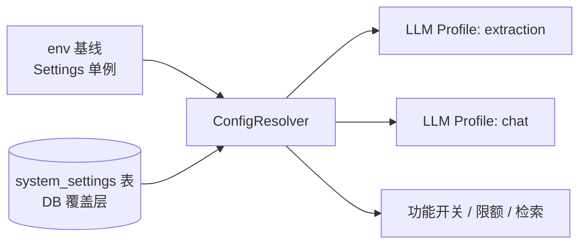
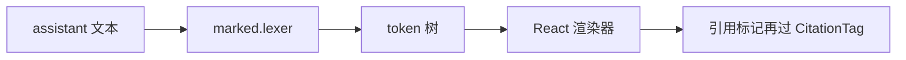
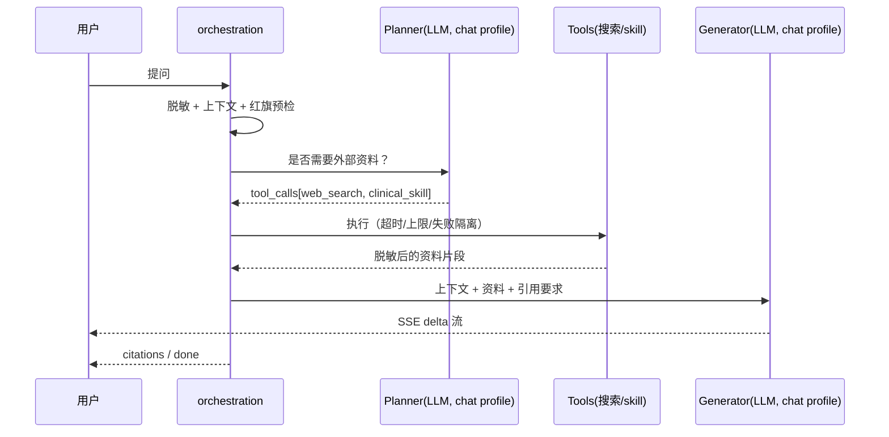

# 系统配置管理 + 问诊 Markdown 渲染 + 问诊 Agent 化 设计方案

> 版本：v1.0 | 日期：2026-10-22
> 关联：`docs/ARCHITECTURE.md` §6.7、`docs/PRD.md` §9.3、`AGENTS.md`「AI 底座原则」、`PLAN.md` §15
> 状态：设计定稿，待实施

---

## 1. 结论（先行）

| 需求 | 结论 | 关键设计取舍 |
|---|---|---|
| 系统配置管理 | 采用「**DB 覆盖层 + env 基线**」双层配置：env 提供安全默认值与启动必需项，DB 提供可在线修改的业务参数；敏感值加密落库、写入单向、读取永远掩码 | 不把 API key 搬到纯 DB（违反 `AGENTS.md` 密钥原则），而是允许 DB 覆盖但加密存储 + 掩码返回 + 审计留痕 |
| LLM 分场景模型 | 引入 **LLM Profile** 概念：`extraction`（成本优先）与 `chat`（能力优先）各自持有 base_url / api_key / model / vlm_model / timeout | 调用方不再直接取 `settings.llm_model`，统一走 `resolve_llm_profile(scenario)` |
| 问诊 Markdown 渲染 | 用 `marked.lexer()` 产出 token 树，**逐 token 渲染为 React 元素**；全程不使用 `dangerouslySetInnerHTML` | 从架构上根除 XSS，同时保留引用标记可点击（token 文本再过 `CitationTag`） |
| 问诊 Agent 化 | 采用「**前置工具轮 + 生成**」两段式（不是自由 ReAct 循环）：模型先决定是否调用搜索/临床 skill，最多 N 轮，工具结果脱敏后注入上下文，再流式生成回答 | 与现有 SSE 单流架构兼容；成本与延迟可控；工具失败可降级为直接回答 |

---

## 2. 范围说明

### 2.1 本期做

1. `system_settings` 表 + 读写 API + 前端配置界面（LLM Profile、检索、脱敏、限额）
2. LLM Profile 解析层，抽取与问诊分别取配置
3. 问诊消息 Markdown 渲染（标题/列表/表格/加粗/代码/引用标签）
4. 问诊 Agent 前置工具轮：网页搜索（DuckDuckGo 免费默认 + SearXNG 可配）、内置临床医学 skill

### 2.2 本期不做（明确反目标）

- **不做** 多租户/多角色配置隔离：当前只有 `Account → Subject`，配置为全局单例，写入仅限首个账户（见 §9 待确认项）
- **不做** 配置热加载到已有进程的连接池：Profile 变更在下一次调用生效（带 30s 缓存 TTL），不重建 DB/Redis 连接
- **不做** 自由多轮 ReAct / 代码执行 / 文件写入类工具：医疗场景只允许只读检索工具
- **不做** 流式输出工具调用过程给用户：只暴露「正在检索资料…」的阶段提示
- **不做** 引用标记改为 Markdown 链接：仍沿用 `[依据 N：标签]` 正则，保证与 `citations.py` 契约不变

---

## 3. 现状分析

| 关注点 | 现状 | 问题 |
|---|---|---|
| 配置来源 | `server/app/config/settings.py` 全部字段来自 env，`lru_cache` 单例 | 改一个阈值要改 `.env` + 重启容器；无界面 |
| LLM 调用 | `app/llm/client.py::LLMClient.__init__` 一次性读 `settings.llm_*`；`_client` 进程级单例 | 单一模型同时服务抽取与问诊，成本与能力无法分别优化 |
| 抽取侧模型 | `preprocessing/parsers/vlm_parser.py` 用 `get_llm_client()` | 与问诊共用 `llm_vlm_model` |
| 问诊侧模型 | `chat/orchestration.py` 直接用 `settings.llm_model` 与 `get_llm_client()` | 同上 |
| 设置接口 | `GET /api/settings` 只读返回 5 个字段；`PATCH` 只支持 `piiMaskingEnabled` | 无通用配置能力 |
| 设置页面 | `web/src/pages/SettingsPage.tsx` 只展示账户、隐私、审计、字典未命中 | 无 LLM / 检索配置入口 |
| 消息渲染 | `web/src/components/CitationTag.tsx` 纯文本 + 引用 chip | 无 Markdown；LLM 输出的表格/列表全部挤成一行 |
| 问诊能力 | `chat/orchestration.py`：脱敏 → 上下文 → 红旗 → 单次 LLM → 引用校验 → SSE | 无外部知识获取途径，只能依赖已入库档案 |

---

## 4. 问题与约束

### 4.1 硬约束

1. **密钥不得进入源码、日志、测试快照**（`AGENTS.md`）。DB 存储必须是密文，API 返回必须掩码，审计只记 key 不记 value。
2. **AI 只在判断环节，不在计算/校验环节**（`AGENTS.md` 第 3 条）。配置写入、限额、审计由代码决定。
3. **AI 失败必须可降级且可观测**（第 4 条）。搜索失败 → 记录 `stage=tool_failed` → 退回无工具回答。
4. **新增 AI 能力必须有离线测试替身**（第 7 条）。搜索与 LLM 都必须可注入 fake。
5. **安全阀优先于智能**（第 8 条）。搜索结果不得直接覆盖红旗规则结论；红旗命中仍优先展示。

### 4.2 现实约束

- 当前无鉴权角色体系，配置写权限只能以「首个账户」或环境变量开关兜底。
- 免费搜索源（DuckDuckGo HTML）无 SLA、可能被限流，必须默认可关闭。
- 问诊 SSE 已有 `meta/delta/citations/redflag/draft/done/error` 事件契约，新增阶段提示不得破坏前端解析。

---

## 5. 方案概述

### 5.1 配置管理：双层配置



- **env 基线**：保留 `Settings` 原有字段，作为「未配置时的安全默认值」和「启动必需项」（`database_url`、`jwt_secret` 等永不进 DB）。
- **DB 覆盖层**：`system_settings(key, value_json, is_secret, scope, updated_by, updated_at)`。
- **解析规则**：DB 有值则覆盖，无值回退 env。解析结果按 key 前缀缓存 30s。

### 5.2 LLM Profile

| Profile | 用途 | 默认取向 | 典型字段 |
|---|---|---|---|
| `extraction` | 文档识别、指标对齐、草稿抽取 | 量大、简单、**成本优先** | 便宜模型 + 低 `max_tokens` + 高并发 |
| `chat` | 问诊对话、临床推理 | 质量、长上下文、能力优先 | 强模型 + 长超时 |

字段：`base_url` / `api_key` / `model` / `vlm_model` / `timeout_seconds` / `max_retries` / `temperature`。

调用侧改造：`get_llm_client(scenario="chat"|"extraction")` 返回按 Profile 构造的客户端；原无参调用默认 `extraction`（保持向后兼容）。

### 5.3 Markdown 渲染（无 HTML 注入）



- 白名单 token：`heading` `paragraph` `list` `table` `code` `blockquote` `hr` `strong` `em` `codespan` `link`（`link` 只渲染为带 `rel="noopener noreferrer"` 的 `<a>`，且仅允许 `http/https`）。
- 未识别 token 一律降级为纯文本，保证永不丢失内容。
- 不使用 `dangerouslySetInnerHTML`，从架构上杜绝 XSS。

### 5.4 Agent 前置工具轮



- **轮数上限**：`agent_max_tool_rounds`（默认 2），超过即进入生成。
- **工具上限**：`agent_max_tool_calls`（默认 3）。
- **超时**：单工具 `agent_tool_timeout_seconds`（默认 8s），超时记 `tool_timeout` 并继续。
- **降级**：`agent_enabled=false` 或 Planner 失败 → 完全跳过工具轮，行为与现状一致。
- **优先级**：红旗命中的「立即就医」卡片不受搜索影响。

---

## 6. 模块划分与职责

### 6.1 后端新增

| 模块 | 职责 |
|---|---|
| `app/config/models.py`（新增 `SystemSetting`） | DB 表映射 |
| `app/config/store.py` | 读写/加密/掩码/缓存失效 |
| `app/config/registry.py` | 配置项白名单（key、类型、默认值、是否敏感、校验器、是否需重启） |
| `app/config/resolver.py` | `resolve(key)` / `resolve_llm_profile(scenario)` / 缓存 |
| `app/config/router.py` | `GET /api/settings/system`、`PATCH /api/settings/system`、`POST /api/settings/system/test` |
| `app/agent/__init__.py` | 包入口 |
| `app/agent/search.py` | `SearchProvider` 协议 + `DuckDuckGoProvider` + `SearxngProvider` |
| `app/agent/skills.py` | 内置临床医学 skill 文本与选择逻辑 |
| `app/agent/tools.py` | 工具定义、执行、超时、结果清理与脱敏 |
| `app/agent/planner.py` | 工具轮规划（LLM JSON 输出 + 严格校验 + 降级） |

### 6.2 后端改造

| 文件 | 改动 |
|---|---|
| `app/llm/client.py` | `get_llm_client(scenario)`；`LLMClient` 接受显式 profile；保留无参兼容 |
| `app/chat/orchestration.py` | 注入 planner + tools；新增 SSE 阶段事件 `status`；`model` 取 `chat` profile |
| `app/preprocessing/parsers/vlm_parser.py` | 显式使用 `extraction` profile |
| `app/preprocessing/indicator_aligner.py` | 同上 |
| `app/audit/router.py` | `GET/PATCH /api/settings` 扩展为兼容旧字段 + 指路新接口 |

### 6.3 前端新增/改造

| 文件 | 改动 |
|---|---|
| `web/src/components/MarkdownMessage.tsx` | 新增：token → React 渲染器 |
| `web/src/components/markdownTokens.ts` | 新增：纯函数 token 规范化（可单测） |
| `web/src/pages/SettingsPage.tsx` | 新增「AI 与检索」区块 + 配置表单 |
| `web/src/api/systemConfig.ts` | 新增 API 封装 |
| `web/src/pages/ChatPage.tsx` | 用 `MarkdownMessage` 替换纯文本；消费 `status` 事件 |
| `web/package.json` | 新增 `marked` |

---

## 7. 接口 / 数据 / 协议设计

### 7.1 数据表

```sql
CREATE TABLE system_settings (
  key          TEXT PRIMARY KEY,
  value_json   JSONB NOT NULL,          -- 明文值或 {"enc": "<fernet token>"}
  is_secret    BOOLEAN NOT NULL DEFAULT FALSE,
  updated_by   TEXT REFERENCES accounts(id) ON DELETE SET NULL,
  updated_at   TIMESTAMPTZ NOT NULL DEFAULT now(),
  created_at   TIMESTAMPTZ NOT NULL DEFAULT now()
);
```

- 敏感值写入：`value_json = {"enc": Fernet.encrypt(plaintext)}`，`is_secret = true`。
- 读取（API）：明文 → 掩码（保留后 4 位）；密文 → 固定 `"••••••••"`。
- 密钥来源：env `CONFIG_SECRET_KEY`；未设置时**拒绝写入敏感项**（返回 422），仅允许读环境值。绝不回退到 `jwt_secret`（避免密钥复用）。

### 7.2 配置项白名单（`registry.py`）

| key | 类型 | 敏感 | 默认（env） | 重启 |
|---|---|---|---|---|
| `llm.extraction.base_url` | str | 否 | `LLM_BASE_URL` | 否 |
| `llm.extraction.api_key` | str | **是** | `LLM_API_KEY` | 否 |
| `llm.extraction.model` | str | 否 | `LLM_MODEL` | 否 |
| `llm.extraction.vlm_model` | str | 否 | `LLM_VLM_MODEL` | 否 |
| `llm.extraction.timeout_seconds` | int(5–300) | 否 | `LLM_TIMEOUT_SECONDS` | 否 |
| `llm.chat.*` | 同上 | 同上 | 同上 | 否 |
| `agent.enabled` | bool | 否 | `false` | 否 |
| `agent.max_tool_rounds` | int(0–3) | 否 | `2` | 否 |
| `agent.max_tool_calls` | int(0–5) | 否 | `3` | 否 |
| `agent.tool_timeout_seconds` | int(3–30) | 否 | `8` | 否 |
| `agent.search_provider` | enum(free_searxng_disabled) | 否 | `none` | 否 |
| `agent.searxng_base_url` | str(url) | 否 | `""` | 否 |
| `agent.free_search_enabled` | bool | 否 | `true` | 否 |
| `agent.max_results` | int(1–10) | 否 | `5` | 否 |
| `privacy.pii_masking_enabled` | bool | 否 | `PII_MASKING_ENABLED` | 否 |
| `upload.max_upload_mb` | int(1–100) | 否 | `MAX_UPLOAD_MB` | 否 |
| `chat.history_limit` | int(5–50) | 否 | `20` | 否 |

### 7.3 API

```
GET  /api/settings/system        → { items: [{key, value|masked, isSecret, source, updatedAt}], editable, secretKeyConfigured }
PATCH /api/settings/system       ← { items: [{key, value}] }  → 逐项校验，任何一项失败整体 422
POST /api/settings/system/test   ← { key }  → LLM: 发一次最小 chat 请求；search: 发一次空查询探测
```

- `source`：`db` | `env`，让运维知道当前值来自哪一层。
- 全部写入记审计 `config.update`（`before`/`after` 仅记非敏感 key，敏感 key 只记 `{"changed": true}`）。

### 7.4 SSE 事件扩展

新增（不破坏既有解析，前端未知事件已 default 忽略）：

```json
event: status
data: {"stage": "agent_tools", "detail": "正在检索外部资料"}
```

`done` 事件追加 `agent: {"usedTools": ["web_search"], "toolErrors": []}`，供前端展示「依据来源」提示。

---

## 8. 关键技术决策与 trade-off

| 决策 | 选择 | 替代方案 | 不选原因 |
|---|---|---|---|
| 配置存储位置 | DB 覆盖 + env 基线 | 纯 DB / 纯 env | 纯 DB 违反密钥原则且启动脆弱；纯 env 无法界面修改 |
| 敏感值处理 | Fernet 加密 + 掩码返回 + 独立 `CONFIG_SECRET_KEY` | 明文存储 / 复用 `jwt_secret` | 明文不可接受；密钥复用放大泄露半径 |
| Markdown 渲染 | token → React 元素 | `dangerouslySetInnerHTML` + DOMPurify | 仍需信任消毒库；token 渲染从源头无 HTML |
| Markdown 库 | `marked`（lexer） | 自研解析 / `react-markdown` | 自研易漏边界；`react-markdown` 依赖树更大，且我们要接引用标记 |
| Agent 形态 | 前置工具轮 + 单次生成 | 自由 ReAct 循环 | 流式输出与引用校验难以对齐；轮数成本不可控 |
| 免费搜索默认 | DuckDuckGo HTML（可关） | Bing free / Wikipedia API | DDG 无需 key、无配额声明；Wikipedia 覆盖面窄 |
| 配置生效 | 30s TTL 缓存 | 立即生效 / 需重启 | 立即生效需跨进程广播；重启代价高 |

---

## 9. 实施步骤（TDD，逐任务可验收）

### 阶段 A — 配置底座（后端）

| # | 任务 | 测试先行 |
|---|---|---|
| A1 | `SystemSetting` 模型 + 迁移 `0003_system_settings.py` | `test_system_settings_model.py` |
| A2 | `registry.py` 白名单 + 类型/范围校验 | `test_config_registry.py`：非法 key、超范围、坏 URL 全部拒绝 |
| A3 | `store.py` 加密/掩码/读写 + 无 `CONFIG_SECRET_KEY` 时拒写敏感项 | `test_config_store.py`：掩码形态、明文不入库、缺密钥 422 |
| A4 | `resolver.py` DB 覆盖 env + TTL 缓存 | `test_config_resolver.py`：优先级、缓存失效、env 回退 |
| A5 | `resolve_llm_profile("chat"/"extraction")` | `test_llm_profile.py`：两场景不同模型、缺项回退、缓存 |
| A6 | `LLMClient` 接 profile；`get_llm_client(scenario)` 兼容无参 | `test_llm_client_profile.py` |

### 阶段 B — 配置 API 与界面

| # | 任务 | 测试先行 |
|---|---|---|
| B1 | `GET/PATCH /api/settings/system` | `test_settings_api.py`：掩码、批量失败回滚、审计 |
| B2 | `POST /api/settings/system/test` | `test_settings_test_endpoint.py`：fake LLM 成功/超时/不可用三路径 |
| B3 | 前端 `api/systemConfig.ts` + `SettingsPage` 区块 | `systemConfig.test.ts`（掩码、提交 payload 形态） |
| B4 | 浏览器实测：改 chat 模型 → 问诊实际用新模型（查日志） | E2E 记录 |

### 阶段 C — Markdown 渲染

| # | 任务 | 测试先行 |
|---|---|---|
| C1 | `markdownTokens.ts` 规范化（白名单、危险 link 过滤） | `markdownTokens.test.ts` |
| C2 | `MarkdownMessage.tsx` 渲染 + 引用 chip 仍可点 | `markdownRender.test.tsx` |
| C3 | `ChatPage` 接入 | 浏览器实测：表格/列表/加粗正常，点引用仍跳原件 |

### 阶段 D — Agent 工具轮

| # | 任务 | 测试先行 |
|---|---|---|
| D1 | `agent/skills.py` 内置临床 skill | `test_clinical_skills.py` |
| D2 | `agent/search.py` 两 provider + fake | `test_agent_search.py`：超时、空结果、非 ASCII 编码、URL 过滤 |
| D3 | `agent/tools.py` 执行/超时/清理/脱敏 | `test_agent_tools.py`：单工具超时不影响整体 |
| D4 | `agent/planner.py` JSON 规划 + 严格校验 + 降级 | `test_agent_planner.py`：坏 JSON→跳过、超轮数→截断、禁用→空 |
| D5 | `orchestration` 接入 + `status` 事件 + `done.agent` | `test_chat_agent_integration.py`：三条路径（启用/禁用/失败降级） |
| D6 | 前端消费 `status` 事件 | `chatAgentStatus.test.ts` |

### 阶段 E — 验收

- 后端全量 `pytest`、前端 `npm test` + `npm run build`
- Compose 重建 + 浏览器实测三类场景
- 回写 `PLAN.md` §15、`docs/ARCHITECTURE.md` §6.9、`docs/PRD.md` §9.4

---

## 10. 风险与兼容性分析

| 级别 | 风险 | 影响 | 缓解 |
|---|---|---|---|
| 高 | 搜索源不可用/限流导致回答质量波动 | 用户体感「有时查不到」 | 默认关闭外部搜索；失败降级为无工具回答并提示「未获取到外部资料」 |
| 高 | 搜索内容含未脱敏个人信息被送入模型 | 隐私泄露 | 工具结果落库前统一走 `sanitizer`；日志只记长度与条数 |
| 中 | DB 配置把 LLM 配错导致全站抽取失败 | 业务中断 | 保存前 `test` 端点验证；错误配置保留上一版（写入前先校验联通性可选） |
| 中 | 敏感项掩码后用户误以为值丢失 | 操作困惑 | 界面明确提示「已保存，出于安全不回显」；提供「保持不变」语义（不传即不改） |
| 中 | Agent 增加单次问诊成本与延迟 | 成本上升 | 轮数/调用数/超时三上限；`agent.enabled` 默认 false |
| 低 | Markdown 表格在移动端溢出 | 体验 | 表格外层 `overflow-x:auto` |
| 低 | 旧 `PATCH /api/settings` 契约变化 | 前端报错 | 保留旧字段语义，仅追加，不删除 |

**回滚**：配置层可整体 `agent.enabled=false` 关闭；DB 覆盖项可逐条删除回退 env；迁移 `0003` 只新增表，不影响既有数据。

---

## 11. 验收与验证建议

| 项 | 判据 |
|---|---|
| 配置生效 | 界面把 `llm.chat.model` 改为模型 B，问诊日志 `llm.call model=B`；`extraction` 仍为模型 A |
| 密钥安全 | DB 查 `system_settings` 中 `api_key` 为 `{"enc": ...}`；API 返回掩码；日志无明文 |
| 无密钥拒写 | 未设 `CONFIG_SECRET_KEY` 时 `PATCH` 敏感项返回 422，且不落库 |
| Markdown | 含表格/列表/加粗/代码的回答正确渲染；含 `[依据 1：xxx]` 处 chip 可点击且能打开原件 |
| XSS | 回答含 `<script>alert(1)</script>` 时渲染为纯文本，控制台无异常 |
| Agent 启用 | 问诊时出现 `status` 事件，`done.agent.usedTools` 含 `web_search`，回答引用外部来源 |
| Agent 禁用 | `agent.enabled=false` 时行为与现状完全一致，SSE 无 `status` 事件 |
| Agent 降级 | 搜索强制超时 → 仍返回完整回答，`toolErrors` 记录原因 |

---

## 12. 待确认项

1. **配置写权限**：当前无角色体系。暂定「首个创建账户可写 + `CONFIG_ADMIN_EMAILS` env 白名单」是否可接受？
2. **免费搜索默认提供方**：DuckDuckGo HTML（无需 key）是否作为默认？还是默认全关、只允许显式配 SearXNG？
3. **敏感配置是否需要 DB 存储**：若坚持「密钥只来自 env/Secret」，则 `api_key` 只读展示、不可界面修改，仅允许改 model/base_url。需要在安全与便利间取一个明确结论。
4. **Agent 默认开关**：上线默认 `agent.enabled=false`（保守）还是 `true`（体验优先）？
5. **`CONFIG_SECRET_KEY` 轮换策略**：轮换后旧密文不可解，需要「重新录入」流程还是自动迁移（用旧 key 解密 + 新 key 加密）？
