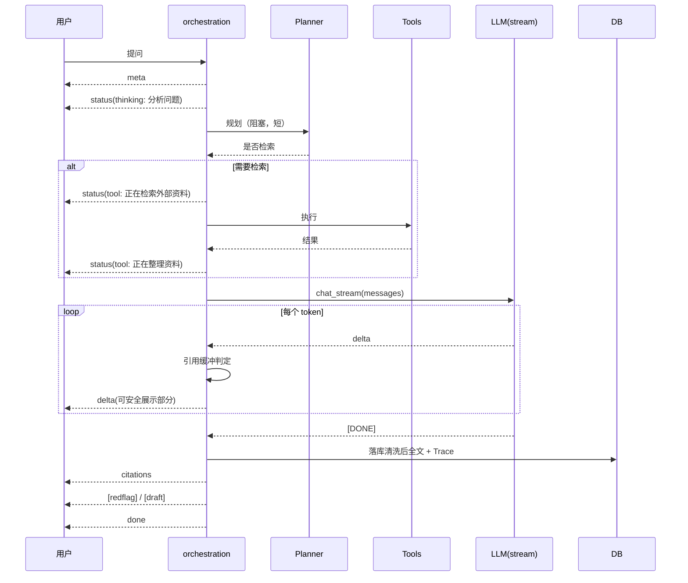

# 问诊真流式输出 + 工具阶段动态反馈 设计方案

> 版本：v1.0 | 日期：2026-10-22
> 关联：`docs/ARCHITECTURE.md` §6.7、`PLAN.md` §19、`AGENTS.md`「AI 底座原则」
> 状态：设计定稿，待实施

---

## 1. 结论（先行）

| 问题 | 当前现状 | 结论 |
|---|---|---|
| 问诊"不支持流式" | `llm.chat()` 是**阻塞调用**，拿到完整回答后才用 `_chunks()` 按 60 字切块、瞬间发完 | 改为 **LLM 原生流式**（`stream=True`），逐 token 转发 delta |
| 首字等待久 | 第一个字要等 Agent 规划 + 工具轮 + 完整生成 | 引入 `status` 阶段事件 + 首字前心跳，消除"卡死"感 |
| 工具阶段无反馈 | 工具轮期间 SSE 无任何事件，用户看到空白 | 工具阶段发细分 `status`（规划/检索/整理），前端显示动态指示 |

**核心判断**：当前不是"SSE 没做好"，而是**上游没流**。前端 `parseSseBlock` + `ReadableStream` 已正确工作（实测事件序完整），所以优化重点在**后端产生流**，前端只需补"阶段动态"。

---

## 2. 范围说明

### 2.1 本期做

1. `LLMClient.chat_stream()`：OpenAI 兼容 `stream=True`，逐块 yield
2. `orchestration` 改为真流式：边收边发 delta，边累积全文
3. 引用清洗的**流式安全策略**（不能等全文再剥除，否则等于不流式）
4. 工具阶段细分 `status` 事件（规划/检索/整理/生成）
5. 首字前心跳 `status`（防止长时间无输出）
6. 前端：阶段动态指示器 + 打字光标 + 首字超时提示
7. 保留 `_chunks` 作为**降级路径**（LLM 不支持 stream 时）

### 2.2 本期不做（反目标）

- **不做** SSE 断线重连：问诊是有状态写操作，重放会重复落库；改用"失败可重试"按钮
- **不做** 多路并发流：单会话单流，避免消息乱序
- **不做** 前端本地打字机假动画：真流式已足够，假动画会掩盖真实延迟
- **不做** 工具轮并行：串行更可控，且并发上限已存在
- **不改** `done` / `citations` / `redflag` / `draft` 既有事件契约（只新增 `status` 细分）

---

## 3. 现状分析（代码事实）

| 位置 | 现状 | 影响 |
|---|---|---|
| `app/llm/client.py::chat()` | `resp = client.chat.completions.create(**kwargs)` 一次性返回 | 阻塞到生成结束，T=完整生成耗时 |
| `app/chat/orchestration.py` | `answer = llm.chat(...)` 后 `for chunk in _chunks(answer)` | delta 在最后集中爆发，用户体感"卡住后瞬间出现" |
| `_chunks(text, size=60)` | 按固定 60 字切分 | 与真实生成节奏无关，是**假流式** |
| `app/agent/planner.py::plan_tools` | 阻塞 LLM 调用（JSON 模式） | 首字前额外 +1 次完整往返 |
| `app/agent/tools.py::execute_tools` | 串行 + 线程超时 | 每次检索最长 8s，期间无输出 |
| `web/src/api/chat.ts::sendMessage` | `ReadableStream` 逐块 `parseSseBlock` | **已正确**，无需改 |
| `web/src/pages/ChatPage.tsx` | `stage` 状态已有，仅显示一行文字 | 动态感不足 |

**实测基线**（改造前）：一次问诊从发送到首字约 6–12s（含规划 + 检索 + 首 token），到完成约 15–25s，期间界面除"思考中…"外无变化。

---

## 4. 问题与约束

### 4.1 硬约束

1. **引用清洗必须与流式共存**：`extract_citations` 需要完整文本才能判断"清单外引用"，流式时不能等。
2. **失败必须可降级**（AGENTS.md 第 4 条）：LLM 不支持 stream / 流中断 → 回退阻塞调用 + `_chunks`。
3. **落库内容必须与展示一致**：`assistant_msg.content` 要等于清洗后的最终文本，不能是流式原始文本。
4. **不破坏既有 SSE 契约**：`meta/delta/citations/redflag/draft/done/error` 全部保留。
5. **测试必须可离线**：`FakeLLM` 需支持流式替身，覆盖"正常流/中途异常/不支持流"三条路径。

### 4.2 引用流式处理的核心难点

`extract_citations` 做两件事：
- 有效标记：**保留原样**（`return m.group(0)`）
- 清单外标记：**替换为空串**（`return ""`）

也就是说，流式期间无法确定某个 `[依据：X]` 是否会被剥除。若先发原文本，后续剥除就会导致**已展示内容被删改**（体验差且不诚实）。

**解决方案**：**引用标记整段缓冲**。
- 检测到 `[` 开始 → 进入 buffer 模式，暂不发送
- 遇到 `]` 或超过 200 字符上限 → 判定为一个引用标记，按 `extract_citations` 同规则处理（保留或剥除），再发送结果
- 普通文本正常即时发送

这样既保持流式，又保证"已发送的内容永不改动"。

---

## 5. 方案概述



### 5.1 阶段状态机（`status` 事件）

| stage | detail | 触发时机 |
|---|---|---|
| `thinking` | 分析问题中 | 收到请求后立即 |
| `planning` | 判断是否需要外部资料 | Agent 规划前 |
| `tool_running` | 正在检索外部资料 | 工具执行前 |
| `tool_done` | 正在整理资料 | 工具完成、开始生成前 |
| `generating` | 正在生成回答 | 首个 delta 之前（仅一次） |
| `heartbeat` | 仍在生成… | 首字后每 5s 无新内容时 |

### 5.2 流式引用处理（状态机）

```
NORMAL ──遇到 '['──> CITE_BUF
CITE_BUF ──遇到 ']'──> 判定（保留/剥除）→ NORMAL
CITE_BUF ──len>200──> 判定为普通文本 → NORMAL（发送 '[' + buffer）
```

---

## 6. 模块划分与职责

| 模块 | 职责 |
|---|---|
| `app/llm/client.py` | 新增 `chat_stream()`；`supports_stream` 探测 |
| `app/chat/stream_utils.py`（新） | `CitationBuffer`（流式引用缓冲判定），纯函数可单测 |
| `app/chat/orchestration.py` | 真流式主循环；阶段事件；降级回退 |
| `web/src/components/chatStatus.ts`（新） | 阶段 → 文案/图标/进度映射（纯函数） |
| `web/src/pages/ChatPage.tsx` | 阶段指示器组件化；打字光标；首字超时提示 |
| `web/src/styles/global.scss` | 指示器动效、光标闪烁 |

---

## 7. 接口 / 协议设计

### 7.1 `LLMClient.chat_stream()`

```python
def chat_stream(
    self,
    messages: List[dict],
    *,
    model: Optional[str] = None,
    temperature: float = 0.1,
) -> Iterator[str]:
    """逐块产出增量文本。失败抛 LLMTimeoutError/LLMUnavailableError。
    调用方负责捕获并降级。
    """
```

### 7.2 SSE 事件扩展（不破坏既有契约）

```json
event: status
data: {"stage": "tool_running", "detail": "正在检索外部资料", "tool": "web_search"}
```

`done` 追加：
```json
{"agent": {...}, "streamed": true, "firstTokenMs": 1234}
```

`streamed=false` 表示走了降级路径，前端可提示"本次为完整输出"。

---

## 8. 关键技术决策与 trade-off

| 决策 | 选择 | 替代方案 | 不选原因 |
|---|---|---|---|
| 流式实现 | LLM 原生 `stream=True` | 缩短 `_chunks` 间隔做假流 | 假流不减少首字延迟，只是延迟分布不同 |
| 引用处理 | 整段缓冲 `[...]` | 先发后改 | 已展示内容被删改，用户可见跳变 |
| 工具阶段 | 细分 4 个 status | 只发 1 个"处理中" | 8s 无变化仍然枯燥 |
| 首字心跳 | 5s 间隔 `status` | 前端本地计时 | 后端心跳更真实（能反映确实还在生成） |
| 失败降级 | 回退阻塞 + `_chunks` | 直接报错 | 宁可慢也不能不出答案 |
| 落库时机 | 流结束后一次性写 | 边流边写 | 避免半截内容入库；写库耗时被 `done` 掩盖 |

---

## 9. 实施步骤（TDD）

| # | 任务 | 测试先行 |
|---|---|---|
| A1 | `CitationBuffer` 状态机（保留/剥除/超长/跨块） | `test_citation_buffer.py` |
| A2 | `LLMClient.chat_stream()` | `test_llm_stream.py`（fake client 三路径） |
| A3 | orchestration 真流式 + 降级 | `test_chat_streaming.py` |
| A4 | 阶段 `status` 事件序列 | 同上（断言事件顺序） |
| A5 | 前端 `chatStatus.ts` 映射 | `chatStatus.test.ts` |
| A6 | 前端阶段指示器 + 光标 | 浏览器实测 |
| A7 | 首字延迟测量与验收 | E2E 记录 `firstTokenMs` |

---

## 10. 风险与兼容性

| 级别 | 风险 | 缓解 |
|---|---|---|
| 高 | 流式中途断连 → 已发内容不完整 | 落库已发部分 + `error` 事件 + 保留重试入口 |
| 高 | 引用缓冲导致长文本卡顿 | 200 字符上限强制冲刷 |
| 中 | 网关不支持 `stream=True` | 探测 + 首块异常即降级阻塞 |
| 中 | 前端 Markdown 每 token 重解析影响性能 | token 累积 30ms 节流渲染（已有 useMemo，实测足够） |
| 低 | `heartbeat` 事件过多 | 仅 5s 间隔且在无新 delta 时发 |

---

## 11. 验收与验证建议

| 项 | 判据 |
|---|---|
| 首字延迟 | 改前 vs 改后 `firstTokenMs` 对比，目标 < 3s（含规划则 < 6s） |
| 流式体感 | 浏览器实测：文字连续出现，非"瞬间全出" |
| 引用正确 | 有效引用渲染为 chip 可点；清单外引用不出现 |
| 引用不闪变 | 已显示文本不因剥除而消失（盯 10 次回答） |
| 工具动态 | 检索期间显示"正在检索外部资料"，非空白 |
| 降级 | 强制 `chat_stream` 抛错 → 仍返回完整答案 + `streamed=false` |
| 落库一致 | DB `content` == 前端最终显示文本 |

---

## 12. 待确认项

1. 首字超时提示阈值：8s 还是 12s？
2. 心跳间隔：5s 是否过密（SSE 事件量）？
3. 是否需要在回答完成后显示"总耗时"？（当前 `done.latencyMs` 已有数据）
