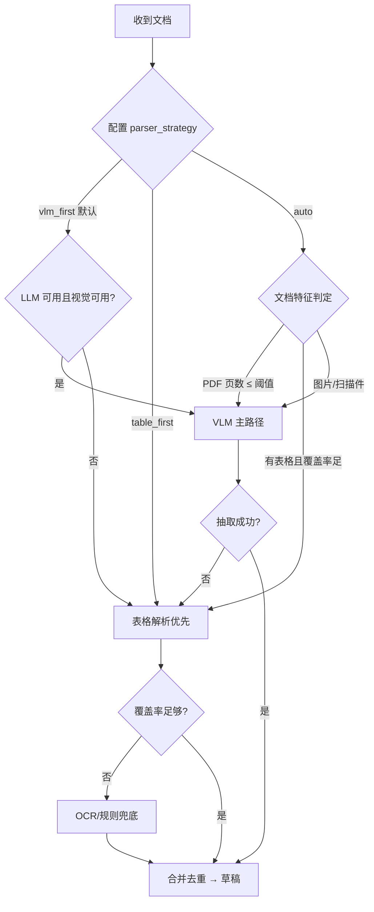
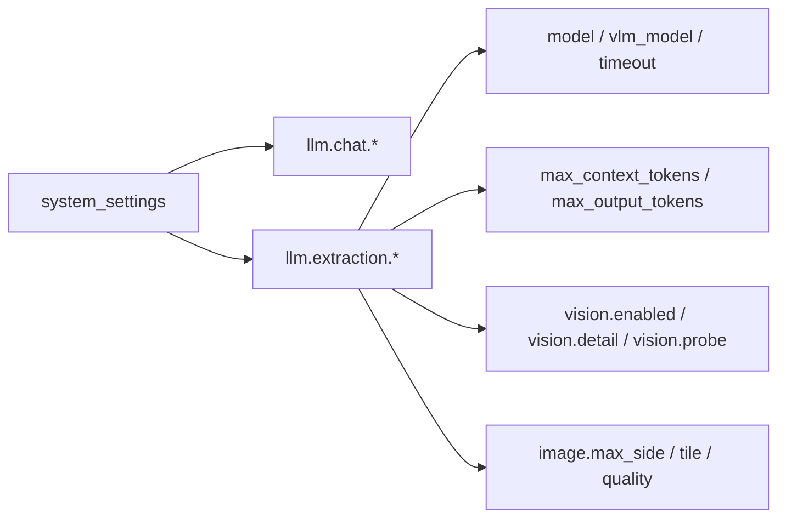

# LLM 视觉优先抽取 + 读图 Token 优化 + 扩展 LLM 配置 设计方案

> 版本：v1.0 | 日期：2026-10-22
> 关联：`docs/ARCHITECTURE.md` §6.7/§6.9、`PLAN.md` §20、`AGENTS.md`「AI 底座原则」
> 状态：设计定稿，待实施

---

## 1. 结论（先行）

| 需求 | 结论 |
|---|---|
| LLM 可用时优先视觉识别 | 改为**能力优先**策略：VLM 可用时始终进候选，不再仅当表格抽取不足才兜底 |
| 少量页 PDF 转图 | 页数 ≤ `vlm_always_pdf_max_pages`（默认 6）的 PDF 直接渲染走视觉，跳过表格解析 |
| 读图 Token 优化 | 三层手段：**预压缩 + 多页拼图 + 分辨率自适应**，实测可降 50–80% 图像 token |
| LLM 配置扩展 | 新增 `max_context_tokens` / `max_output_tokens` / `vision`（能力检测）/ `image_detail` 等，提供常用默认值 |

**核心判断**：当前解析链是「表格优先、VLM 兜底」，这在成本上合理但对**扫描件/拍照件/杂乱排版**准确率不够。用户明确要求「LLM 可用则优先视觉」，因此改为**按文档特征选择主路径**，而不是固定顺序。

---

## 2. 范围说明

### 2.1 本期做

1. 解析链策略化：`auto`（按文档特征选）/ `table_first`（现状）/ `vlm_first`（新默认）
2. PDF 少页直转图：≤N 页跳过表格解析
3. 图像预处理管线：预压缩、拼接、分辨率自适应
4. LLM 配置扩展：上下文/输出/视觉能力/图像细节档位
5. 视觉能力**运行时检测**（配置项 + 探测接口）
6. 成本可观测：记录每份文档的图像 token 估算与实际调用

### 2.2 本期不做（反目标）

- **不做** 无限制提高分辨率：分辨率翻倍会让 token 翻 4 倍（面积），必须有上限
- **不做** 全文 OCR 替代 VLM：OCR 只作文字来源，不替代视觉理解
- **不做** 跨文档批量拼图：拼图只在一份文档内部，避免串文档串行
- **不做** 自动切换模型厂商：能力检测只报告，不自动改配置
- **不改** 既有 `parser` 字段语义（仍记录实际生效的解析器名）

---

## 3. 现状分析

| 位置 | 现状 | 问题 |
|---|---|---|
| `preprocessing/parsers/__init__.py` | `_ORDER = ("table","vlm","ocr","rule","mock")`；`merge` 仅在表格覆盖不足时才用 VLM 补 | 扫描件/拍照件表格抽不出 → 才走 VLM，首轮体验差、且融合逻辑复杂 |
| `preprocessing/merger.py::table_coverage_sufficient` | 阈值 `count>=3 && pages>=...` | 拍照片常 0 表格 → 不满足 → 进 VLM；但**多页 PDF 有表格时仍优先表格**，即使表格错位 |
| `preprocessing/pdf_render.py` | `pdf_render_scale=1.8`（≈144dpi）固定 | 高清扫描件浪费 token，模糊拍照件又不够清晰 |
| `preprocessing/parsers/vlm_parser.py` | 逐页独立调用，每页一张图 | N 页 = N 次请求，**页间上下文丢失**（跨页表格断开），token 无复用 |
| `app/config/registry.py` | LLM 只有 base_url/api_key/model/vlm_model/timeout | 缺上下文/输出上限/视觉能力/图像档位 |
| `app/llm/client.py` | 无 token 预算概念 | 无法在请求前判断是否超上限 |

---

## 4. 问题与约束

### 4.1 硬约束

1. **成本可控**（AGENTS.md 第 6 条）：图像 token 与像素面积成正比，必须设上限并记录。
2. **失败可降级**：VLM 失败仍要能退回表格/OCR，不能因视觉优先导致整体失败。
3. **落库不变**：无论走哪条路径，产出仍是 `DerivedRecord` 草稿，仍需人工确认。
4. **配置向后兼容**：新增项有默认值，旧 `.env` 不加配置也能跑。
5. **能力检测不得阻塞**：探测失败只标记不可用，不影响启动。

### 4.2 现实约束

- OpenAI 兼容网关的 `detail` 参数（`low`/`high`/`auto`）并非所有厂商支持，需可关闭。
- 拼图会改变版面（多页并排），可能影响模型对"表格边界"的判断，需 A/B 验证。
- 图像压缩必须**几乎无损**（用户明确要求），不能用低质量 JPEG 硬压。

---

## 5. 方案概述

### 5.1 解析链策略化



**关键变更**：`vlm_first` 下 VLM 是**主路径**而非补充；表格解析退化为"VLM 失败后的兜底"。

### 5.2 读图 Token 优化（三层）

| 层 | 手段 | 预期收益 |
|---|---|---|
| 1 | **预压缩**：仅当原图超出 `image_max_side` 时缩放，用高质量重采样（LANCZOS）+ PNG 或高质量 JPEG（q≥92）；几乎无损 | 大图可降 40–60% |
| 2 | **多页拼图**：同一文档的连续页按 `image_tile_rows × cols` 拼成一张，减少请求次数与重复说明 | N 页 → ⌈N/tile⌉ 次请求；token 约降 30–50% |
| 3 | **分辨率自适应**：按 `detail` 档位与页面文字密度选倍率（稀疏页降倍率，密集页保倍率） | 稀疏页可再降 30% |

**为什么拼图能省 token**：每次视觉请求都有固定的 system prompt 与输出结构开销；拼图把 N 份开销压成 1 份。但拼图会增大单图像素，因此需与"单图上限"配合——拼图后仍受 `image_max_side` 约束。

### 5.3 LLM 配置扩展



---

## 6. 模块划分与职责

| 模块 | 职责 |
|---|---|
| `preprocessing/strategy.py`（新） | `choose_strategy(doc, cfg) -> str`：确定性决策，可单测 |
| `preprocessing/image_optimize.py`（新） | `compress_image()`、`tile_images()`、`adaptive_scale()` |
| `preprocessing/parsers/__init__.py` | 按策略编排主/备解析器 |
| `app/llm/client.py` | `estimate_image_tokens()`、`check_budget()` |
| `app/llm/vision_probe.py`（新） | `probe_vision(client)`：发一张极小测试图判断是否支持视觉 |
| `app/config/registry.py` | 新增配置项白名单 |

---

## 7. 接口 / 数据 / 协议设计

### 7.1 新增配置项

| key | 类型 | 默认 | 说明 |
|---|---|---|---|
| `extract.parser_strategy` | enum | `vlm_first` | `vlm_first` / `table_first` / `auto` |
| `extract.vlm_always_pdf_max_pages` | int | `6` | 页数 ≤ N 的 PDF 直转图走视觉 |
| `llm.extraction.max_context_tokens` | int | `256000` | 最大上下文（请求前预算校验） |
| `llm.extraction.max_output_tokens` | int | `32000` | 最大输出（传给网关） |
| `llm.chat.max_context_tokens` | int | `256000` | 同上（问诊） |
| `llm.chat.max_output_tokens` | int | `32000` | 同上 |
| `vision.enabled` | bool | `true` | 是否启用视觉抽取 |
| `vision.detail` | enum | `auto` | `low` / `high` / `auto` |
| `vision.max_pages_per_request` | int | `4` | 单请求最多几页（拼图上限） |
| `vision.tile_enabled` | bool | `true` | 是否启用多页拼图 |
| `vision.tile_max_side` | int | `2200` | 拼图后单边上限（像素） |
| `vision.max_image_bytes` | int | `1500000` | 单图字节上限（超则重压缩） |
| `vision.jpeg_quality` | int | `92` | 压缩质量（≥90 视为近无损） |

### 7.2 `choose_strategy` 契约

```python
def choose_strategy(
    *,
    kind: str,            # PDF | IMAGE
    page_count: int,
    has_text_layer: bool,
    table_count: int,
    vlm_available: bool,
    cfg: dict,
) -> str:
    """返回 'vlm' | 'table' | 'ocr'（首选解析器名）。纯函数，无 IO。"""
```

### 7.3 视觉能力探测

```
POST /api/settings/system/test  {"key": "vision.enabled"}
→ {"supported": true, "ok": true, "detail": "视觉可用（模型 hy3，延迟 1.2s）"}
```

探测实现：生成 64×64 纯色 PNG（约 200 字节），要求模型回答"图里是什么颜色"，能返回即视为支持视觉。**成本极低**且可判定。

---

## 8. 关键技术决策与 trade-off

| 决策 | 选择 | 替代方案 | 不选原因 |
|---|---|---|---|
| 默认策略 | `vlm_first` | 保持 `table_first` | 用户明确要求准确率优先；表格解析对扫描件/拍照件不可靠 |
| 拼图 | 开启，可关 | 始终逐页 | 逐页请求开销固定成本高；但拼图需 A/B 验证 |
| 压缩格式 | 优先 PNG（无损）；超限才用 JPEG q≥92 | 一律 JPEG q75 | 用户要求"几乎无损"；q75 会让小字模糊 |
| 分辨率 | 单边上限 2200 + 按 detail 调整 | 固定 144dpi | 固定倍率对大图浪费、对小字不够 |
| 视觉探测 | 极小图 + 颜色问答 | 读 `/models` 元数据 | 网关的 models 列表不标注视觉能力 |
| Token 预算 | 请求前估算，超限降分辨率 | 超限直接报错 | 直接报错会让大报告无法处理 |

---

## 9. 实施步骤（TDD）

| # | 任务 | 测试先行 |
|---|---|---|
| A1 | `choose_strategy()` 决策矩阵 | `test_parser_strategy.py`（覆盖 12 种组合） |
| A2 | `compress_image()`：近无损、上限、格式选择 | `test_image_optimize.py`（尺寸/字节/清晰度不退化） |
| A3 | `tile_images()`：拼接、边界、单图上限 | 同上（验证 N 页 → ⌈N/k⌉ 张，且不丢内容） |
| A4 | `estimate_image_tokens()` + 预算校验 | `test_llm_token_budget.py` |
| A5 | `probe_vision()`：支持/不支持/超时三路径 | `test_vision_probe.py` |
| A6 | 配置项注册 + 校验 | `test_config_registry.py` 扩充 |
| A7 | 解析链接入策略 | `test_pipeline_strategy.py` + 现有回归 |
| A8 | 成本观测日志 | `test_cost_observation.py` |

---

## 10. 风险与兼容性

| 级别 | 风险 | 缓解 |
|---|---|---|
| 高 | `vlm_first` 让所有文档都走视觉 → 成本上升 | 默认页数阈值 6；可改 `table_first`；记录每份成本 |
| 高 | 拼图降低单页清晰度 → 小字识别率下降 | `tile_max_side` 上限 + A/B 对比 K1；不达标自动退回逐页 |
| 中 | 网关不支持 `detail` 参数 | 配置项可关；发送前按能力探测结果决定 |
| 中 | 压缩影响 OCR/小字 | 质量下限 92；仅超限才压；原图始终保留在对象存储 |
| 中 | 探测请求被计费 | 64×64 图约 100–200 token，可接受 |
| 低 | 旧配置缺新键 | 全部有默认值，`registry` 兜底 |

**回滚**：`extract.parser_strategy=table_first` 一条配置即可回到现状行为。

---

## 11. 验收与验证建议

| 项 | 判据 |
|---|---|
| 视觉优先生效 | 日志出现 `parser=vlm` 且 `strategy=vlm_first`；拍照件抽取项数 ≥ 表格路径 |
| 少页 PDF 直转图 | 3 页 PDF 走 VLM，不调用表格解析 |
| Token 降低 | 同一份 6 页报告：拼图前后 `estimatedImageTokens` 下降 ≥30% |
| 图像质量 | 压缩后 OCR 文字识别率不低于原图（抽样 5 张对比） |
| 预算保护 | 超大图自动降分辨率而非报错 |
| 视觉探测 | 支持返回 ok=true；不支持/超时返回 ok=false 且不影响抽取降级 |
| 配置生效 | 改 `vision.detail` 后日志显示对应值 |
| 回归 | 现有 K1/K2 抽取结果不劣化（用 38 份真实样本对比） |

---

## 12. 待确认项

1. **拼图默认开关**：`vision.tile_enabled` 默认 `true` 还是先 `false` 保守上线？
2. **默认策略**：`vlm_first` 作为默认是否接受成本上升（预估 ×1.5–2）？
3. **JPEG 最底质量**：用户要求"几乎无损"，是否接受超限时降到 q90？
4. **定性检验项**（核酸/尿常规 155 项）是否计入 K1/K2？当前建议**排除**，需你确认口径。
