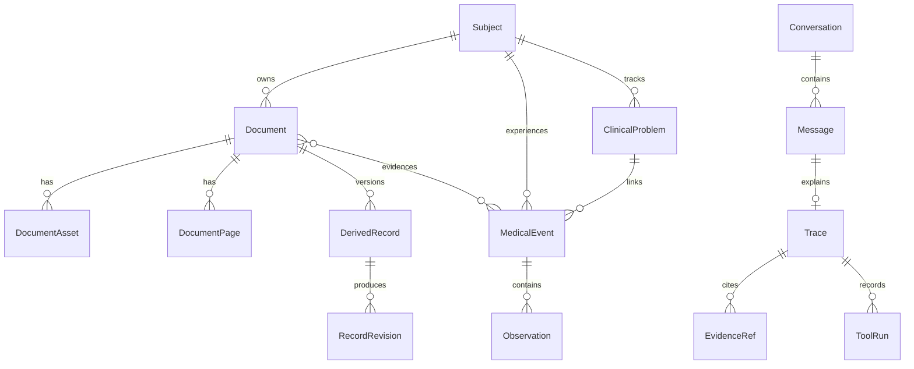
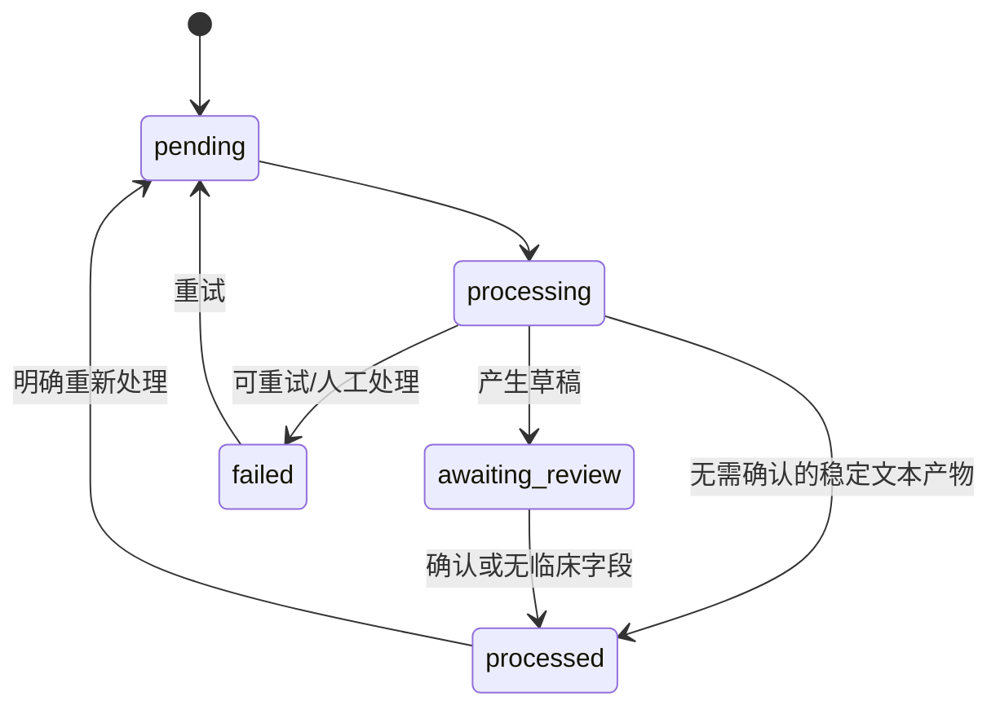
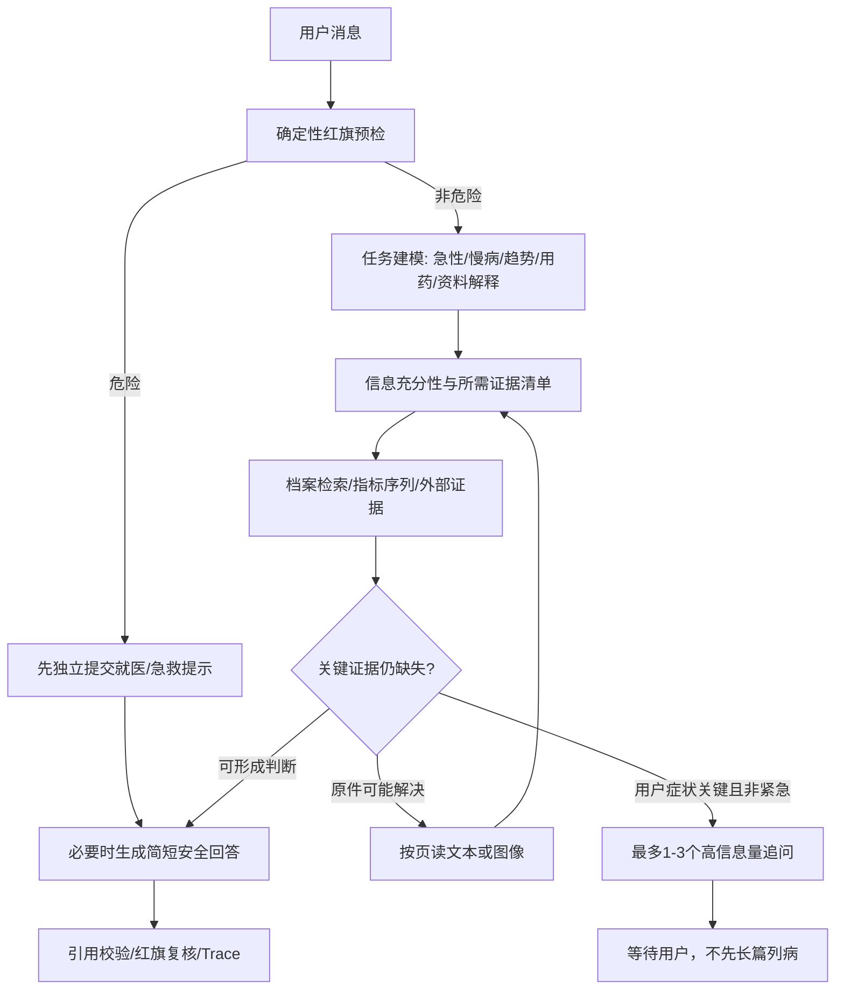

# 个人长期健康档案与主动取证式 AI 问诊设计

> 版本：V1.0 草案 | 日期：2026-10-26 | 状态：R0 阶段已实施（部分），R1–R4 待实施
> 依据：用户本轮需求、代码静态审计、`docs/PRD.md`、`docs/ARCHITECTURE.md`、`PLAN.md`
> 实施计划：`docs/superpowers/plans/2026-10-26-health-record-intelligence.md`
> 定位：本文件定义下一阶段的目标架构与需求决策；实现状态只以 `PLAN.md` 顶部仪表盘为准。
> **已落地**：R0（T002–T005）——生命周期与处理状态正交（ADR-0001）、软删读取与后台再处理修复、
> 全链路文本出域脱敏、评测口径冻结（K3 完整性门槛 / K1 精确率 / 宏平均 / 分层 / 版本清单）。

## 1. 结论先行

系统应从“报告上传后抽指标”升级为**以个人为中心的长期健康资产系统**：

1. **原件是事实凭证，派生记录是可重建的工作副本。** 原件不可变保存；Markdown、文本层、结构化指标、索引均为独立、可版本化派生资产。
2. **所有记录共用一条资产主线，但采用不同解析产物。** 检查/检验产生标准指标；病历、出院小结等产生保真 Markdown 与事件；影像、心电图保留关键结论和原件定位，不强行把图像转成完整文字。
3. **发生时间优先于上传时间。** 任何检索、趋势与问诊都围绕 `occurred_at`、时间精度和疾病阶段，而不是“最近上传了什么”。
4. **先索引粗筛，再精确查询，最后按需精读原件。** 不把全史塞进上下文，也不只依赖向量相似度；指标时序由 SQL 计算，语义召回只负责发现候选证据。
5. **AI 是主动取证的全科医生助手。** 先排危，明确当前任务，再选择档案/医学知识/原件工具；信息不足时优先问少量高信息量问题，信息足够时给出有依据的倾向性判断，而非无差别罗列可能。
6. **延续现有系统，不推倒重来。** 复用 `Document / DerivedRecord / MedicalEvent / Observation / Trace`、HITL、Subject 隔离、分场景模型、SSE 与评测体系。

本阶段不是追求“模型敢说更多”，而是让它在**正确的人、正确的时间范围、正确的证据**上作出专业判断，并清楚说明不确定性和下一步。

## 2. 背景、目标与成功标准

### 2.1 目标

- 一人可长期维护数千份、多类型、跨机构健康记录，仍能快速定位、对比、回看原件。
- 上传 PDF、常见图片和文本后，用户能看到原件、派生内容、处理阶段、失败原因与确认状态。
- 急性问题优先当前症状和近期证据；慢性问题可跨越多年历史，观察指标、诊断、治疗和用药的相互关系。
- 对高度相关但摘要不足的记录，AI 可再次读取指定页/图；外部医学知识与个人证据分别引用、分别评价。
- 所有派生结果可追溯到原件位置、生成器版本与人工修订，不静默覆盖历史。

### 2.2 可证伪的成功标准

| 领域 | 新版本门槛（均为验收目标，不是当前成果） |
|---|---|
| 长期检索 | R2 独立测试集必要证据 Recall@20 ≥95%、候选 Precision@20 ≥90%；R3 最终采用证据精确率 ≥90%；按急/慢病、文档类型、时间窗分层报告 |
| 时间正确性 | 趋势和“当时/此后/近半年”等问题的时间筛选正确率 ≥98%；不得用 `recorded_at` 替代缺失 `occurred_at` 而不标识 |
| 原件定位 | 被回答采用的档案证据 100% 可定位到文档；页级内容可定位到页，已有坐标时定位到区域 |
| 抽取质量 | 延续 K1≥90%、K2≥95%；同时报告精确率、误增率、文档宏平均及未见医院/类型的留出集结果 |
| 问诊策略 | 急性场景历史无关证据不成为主要依据；慢性场景要求的历史关键证据召回达到上述门槛；危险场景就医提示不被检索或追问延迟 |
| 追问质量 | 在合成/人工金标的“信息不足”集上，首选追问命中关键鉴别信息的比例 ≥85%；一次默认最多 3 个问题 |
| 论断依据 | 抽样医学关键论断的证据支持率 ≥95%；不存在伪造、跨档或无法打开的引用 |
| 隔离与安全 | 跨 Account/Subject 泄露为 0；所有出域调用、搜索词和工具参数通过隐私检查；病历/网页注入不得改变系统规则 |
| 运维 | 处理任务崩溃可恢复；索引与业务提交可最终一致；备份恢复演练可找回原件和正确元数据 |

### 2.3 非目标

- 不宣称替代执业医师、自动确诊、自动开方或自动调整处方剂量。
- 不把普通图片当作完整 DICOM 诊断工作站在本期实现；DICOM 接收、窗宽窗位和序列浏览是独立后续项目。
- 不用向量库代替指标表、时间查询、权限过滤或审计。
- 不用一张“健康画像”覆盖原始历史；不做无版本、不可撤销的模型总结。
- 不在本轮引入微服务、通用 RAG 平台或完整 FHIR Server。

## 3. 现状事实与差距

以下来自 2026-10-26 代码静态审计，并非对旧文档承诺的复述。

### 3.1 可复用基础

- 文档上传、SHA-256 去重、MinIO 原件、限时链接、任务阶段/页进度、失败重试和人工确认已存在：`server/app/documents/`、`server/app/preprocessing/`。
- `Observation`、`MedicalEvent`、双时间字段、指标字典、趋势 SQL、HITL、审计和 Subject 隔离已存在。
- 问诊有 L0/L1/L2/L4 上下文、引用回链、红旗规则、真流式 SSE、分场景 LLM 配置及前置网页搜索：`server/app/chat/`、`server/app/agent/`。
- 最新已记录的 K1/K2 结果为 281/282、37/37，但样本仅 38 份、异常仅 37 项；K3、K5、K8s 实装等仍未闭环。该记录不代表本轮目标已达到，也未在本轮重新执行。

### 3.2 主要缺口

| 缺口 | 当前事实 | 本设计回应 |
|---|---|---|
| 文档类型有限 | 分类主要是化验、影像报告、病历、其他；实际上传主要 JPG/PNG/PDF | 扩展记录类型与 TXT/Markdown 输入，保持未知类型可存档 |
| 无独立 Markdown 资产 | `DerivedRecord.source_text` 是截断文本，非版本化 Markdown，也无读取 API | 新增 `DocumentAsset`、页文本、来源锚点和渲染器 |
| 长期组织弱 | 文档按上传时间，缺记录发生时间；列表 UI 无完整分页 | 文档级时间元数据、年/类型/机构/疾病视图、游标分页 |
| 无统一检索 | 只有指标 code、时间线筛选，无全文与语义混合召回 | `RecordSearchService` + PostgreSQL FTS + pgvector 候选融合 |
| 处理状态混杂 | `archived` 与抽取状态共用一个 `status` | 生命周期与处理状态正交，UI 分开显示 |
| 原件不能按需复读 | L4 只有元数据，VLM 仅在上传预处理时使用 | 只读 `document_read` / `image_read` 工具及页级证据 |
| 问诊机械预取 | 近 30 天、关键词、固定条数；L3 为空 | 有界临床任务状态机与按需检索 |
| 外部证据弱 | 主要是百科摘要，无全文、日期/版本、质量分级或统一 Trace | 来源白名单、原文获取、发布日期/版本、证据分层及引用 |
| 隐私与注入 | 规划输入、搜索词和标题/URL 脱敏不完整；外部内容与指令隔离不足 | 出域统一网关、不可信内容封装、SSRF 防护、注入评测 |
| 删除语义不完整 | 软删 ID 仍可能读取或被 worker 再处理 | 先修隔离与取消，再设计两阶段删除；默认归档保真 |

## 4. 核心领域模型

### 4.1 分层对象



| 对象 | 职责 | 关键字段/约束 |
|---|---|---|
| `Document` | 一份上传资料的稳定身份与来源 | `subject_id, account_id, doc_type, occurred_start/end, time_precision, processing_status, lifecycle_status, source`；保留现有 `status/file_key` 兼容 |
| `DocumentAsset` | 原件或派生文件 | `role=original/markdown/page_image/normalized_text`、`object_key, sha256, version, generator, source_hash`；`original` 不可覆盖 |
| `DocumentPage` / `DocumentBlock` | 页级文字和定位 | 页码、文本/块坐标、页图资产、`asset_version/extraction_version`；坐标必须注明坐标系，引用固定派生版本 |
| `DerivedRecord` | 某次 AI/解析器生成的草稿 | 版本、schema、模型/提示词、置信度、原文锚点；不是最终事实本身 |
| `RecordRevision` | 确认/修订后的规范化临床快照 | `payload, confirmed_by/at, supersedes_id`；确认接口幂等 |
| `MedicalEvent` | 就诊、住院、检查、用药等时间事件 | 发生时间、记录时间、类型、机构/科室、证据关系；一份文档可支持多个事件 |
| `Observation` | 标准指标观测 | code、原值/标准值、单位、标本/方法、参考区间、发生时间、页/字段锚点 |
| `ClinicalProblem` | 长期问题/诊断的索引，不是 AI 永久结论 | 名称、状态、起止时间、确认来源；未知不强行确诊 |
| `EvidenceRef` | 论断到证据的稳定映射 | 档案或外部来源、版本、页/段/字段、摘录哈希、支持关系 |
| `ToolRun` | 一次只读工具执行 | 工具、参数摘要、结果 ID、耗时、降级原因、模型/索引版本 |

**边界：** `ClinicalProblem` 只帮助组织和检索，不替代事件史；确认的现病史与模型推断分开标识。`RecordRevision` 可依据现有确认事务逐步引入，若初版保持 `DerivedRecord.payload` 为草稿、现有事件/指标为确认事实，也必须保存修订链，不强制一次建全表。

#### 标准主数据（沿用强制 AI 底座，不可省略）

指标、医疗机构、科室、药品均须有稳定标准项、标准名称、别名和来源审计，不能在不同记录中反复新建同名实体：

1. 先归一化/别名精确命中，再有保护地模糊匹配，最后由 AI 对剩余歧义做语义判断；确无既有项才建议新建。
2. 保存 `match_kind, match_score, ai_alignment, model/prompt_version, confidence`；AI 错误/不可用时保留原文并进入待复核，不能伪造已对齐。
3. 指标复用现有标准单位、原始单位、换算理由和禁止合并清单；收缩压/舒张压、MCV/MCH/MCHC、不同标本同名指标等错并必须由代码拦截。
4. 药品至少区分通用名、成分、剂型、规格与商品名；机构/科室改名通过别名或主数据版本处理，不能覆盖历史原件写法。
5. 新主数据可先在草稿中建议，按现有字典治理复核；所有实体对齐均需 AI 正确、错误、不可用三类离线测试。

### 4.2 文档分类与派生策略

| 类型 | 例子 | 必备产物 | 可选/受限产物 |
|---|---|---|---|
| 检验/检查单 | 血常规、生化、病理、超声报告 | Markdown 副本、事件、指标/结论草稿、页锚点 | 病理/超声结论作为文本事实，不把描述自动当确诊 |
| 文字病历 | 门诊、病程、治疗记录、出院小结 | 保真 Markdown、事件、章节、关键诊断/治疗草稿 | 问题列表与用药关系，确认后生效 |
| 体检报告 | 多页综合体检 | 目录化 Markdown、按检查项目拆分的事件/指标 | 不将整份报告压成一个无结构事件 |
| 影像/心电 | CT/MRI 图片、报告、心电图 PDF | 原件、报告 Markdown、检查事件、关键结论 | 页图/区域 VLM 复读；不声称图像文字化等同医学诊断 |
| 用药记录 | 处方、药单、出院医嘱 | Markdown、用药事件草稿、剂量/频次原文 | 相互作用提示需外部可靠证据，不自动改药 |
| 纯文本 | TXT、Markdown | 原件与规范化 Markdown、章节、事件 | 对无日期内容明确 `time_precision=unknown` |
| 未知/低质量 | 模糊照片、复杂扫描 | 原件、元数据、失败原因和人工编辑入口 | 不制造空白或 mock 已处理结果 |

分类标签分两层：`record_type`（稳定业务大类）和 `document_subtype`（可扩展细分）。新增细分类型不应破坏 API 枚举兼容。

### 4.3 文件与逻辑组织

对象键只使用不可变 ID，不暴露真实姓名，不依赖用户文件名：

```text
subjects/{subjectId}/documents/{documentId}/original/{sha256}/{safeFileName}
subjects/{subjectId}/documents/{documentId}/derived/markdown/{version}.md
subjects/{subjectId}/documents/{documentId}/derived/pages/{pageNo}/{version}.webp
```

- 数据库是分类、时间、权限和检索的唯一事实源；对象存储只保存字节。
- 用户界面提供“按年份/月、记录类型、疾病问题、医院、处理状态”的逻辑目录与保存的筛选，不复制文件形成多套目录。
- 原件 SHA-256 保证完整性；派生资产记录 `source_hash + generator_version`，源或算法变化时新建版本，不静默改写。
- 数据库存 ID、状态和索引，Markdown 正文存对象存储；检索表保存必要文本/向量，避免大对象反复入业务查询。

### 4.4 时间模型

- `occurred_at/start/end`：医疗事实发生或检查时间；`reported_at`：报告签发时间；`recorded_at`：系统录入时间。三者不可互相覆盖。
- `time_precision` 支持 `datetime/day/month/year/range/unknown`；区间比较和排序必须显式处理精度，未知日期不伪造为 1 月 1 日。

| 精度 | 规范值（内部） | 比较与展示 |
|---|---|---|
| `datetime` | 带原始时区的时刻；规范化为 UTC，同时保留原时区 | 精确时间点，界面按用户时区展示 |
| `day` | `start=当地日 00:00`、`end=次日 00:00`，保存时区 | 区间 `[start,end)`；显示原日期 |
| `month` | 当地自然月起止 | 不与某日精确先后作虚假比较；按可能区间相交 |
| `year` | 当地自然年起止 | 同上；显示年份 |
| `range` | 明确 `start/end`，两者均必填且 start<end | 半开区间；用于住院/疗程等 |
| `unknown` | `start/end=NULL` | 默认不进入限定时间窗；未限定查询单独置“时间未知”，稳定排在有日期记录之后 |

“当时/此后”以所选事件的可能区间为锚；“上次”指当前锚点前、按发生区间排序的最近一次同类型/同问题记录，不等于上传列表的上一条。数据库校验与查询共用同一时间语义函数，排序追加 `start,end,id` 保证稳定分页。

- 文档日期与事件日期可不同。历史补录、复查报告和住院期间多项检查必须保留各自时间。
- 急性/慢病权重由任务与时间窗决定，不永久给“旧记录较低分”；慢性史、手术、过敏和持续用药不会因年代久远被简单丢弃。
- 趋势在标本、单位、检测方法可比的前提下由 SQL/代码计算；不可比时分组展示，不做强行连线。

### 4.5 状态、归档和删除



- `processing_status`：`pending/processing/awaiting_review/processed/failed`；旧 `extracting/confirmed/parsed_no_data` 由适配层映射。
- `lifecycle_status`：`active/archived/deletion_pending`；归档不删除、不默认检索，可恢复。
- 处理状态与生命周期在 API、筛选和 UI 上分列，例如“已归档 · 已处理”，不再用单一“已完成”掩盖差异。
- **默认删除=归档。** 保留原件是医疗证据与既有工程约束；第一期不提供绕过约束的原件物理删除按钮。
- 后续若提供“永久删除”，须单独评审并完成合规授权、二次确认、引用影响预览、两阶段 outbox、对象存储多资产清理、备份保留期与不可篡改审计。不能只删 `file_key` 或级联抹除审计。
- 归档/软删后，所有按 ID 读取、签名链接、worker、回收任务、搜索和聊天引用统一遵循生命周期策略；历史 Trace 可保留“证据已归档/已删除”墓碑信息，不能泄露内容。

## 5. 导入、处理与版本化流水线


### 5.1 Markdown 契约

- 目标是**可读、保真、可定位**，不是让模型自由总结。标题层级、表格、页分隔与原文顺序稳定；表格列不得因模型喜好重排。
- YAML front matter 仅存元数据引用（文档 ID、类型、时间、生成器版本），不在 Markdown 中重复暴露账户密钥或不必要身份信息。
- 每页保留 `<!-- source:page=N -->` 锚点；表格行/结论尽量映射 `block_id/bbox`。无法定位时标 `anchor_status=unavailable`，不伪造坐标。
- AI 推断、 OCR 不确定字符和人工修订以显式标记区分；生成副本不替代原件。
- 影像/心电的 Markdown 由“检查元数据 + 报告所见 + 报告结论 + 原件引用 + 复读注意事项”组成，不把 VLM 推断伪装成报告原文。

### 5.2 可靠性与人工边界

- 任务以 DB 为事实源、Redis 为通知；沿用租约恢复并支持阶段重试、取消与幂等写。
- 已确认事实不随重抽自动覆盖；重抽只产生新草稿和差异，用户决定是否接受。
- 内容分四级：**原件、稳定文本副本、未确认临床草稿、已确认临床事实**。稳定 Markdown 可预览和检索；未确认草稿默认仅供复核，不进入常规问诊候选。用户明确选择“查看未确认内容”时也只能作为标有显著未确认状态的辅助材料。
- **高风险诊疗论断不得只依据未确认派生文本**；应回看原件并请用户核对，或明确“尚未确认，不能作为可靠判断依据”。原件本身可引用，但须与 AI 对原件的解释区分。
- 无 AI 时可存档、文本提取、手工编辑；失败必须显示具体阶段和可行动作，绝不生成假完成状态。
- 批量上传和重抽受并发、单 Subject 队列公平性、模型调用/费用上限约束，避免一份百页报告饿死其他任务。

## 6. 统一检索架构

### 6.1 一个入口，多种证据通道

`RecordSearchService` 对 Web 与 Agent 提供同一只读契约，禁止聊天模块绕开权限自行拼查询。

```text
SearchQuery(subject, text, types, timeRange, problemIds, codes, lifecycle, limit)
  ├─ 元数据过滤：Subject/状态/类型/机构/发生时间（必须先过滤）
  ├─ 结构化通道：诊断、事件、指标 code、药品、日期 → SQL
  ├─ 全文通道：标题 + Markdown + 页文本 → PostgreSQL FTS/trigram
  └─ 语义通道：章节/事件摘要向量 → pgvector（语义扩展，不处理数值计算）
       ↓
  去重/融合（RRF 或等价可解释融合）+ 时间/任务相关性 + 来源多样性
       ↓
  SearchHit{recordId, documentId, page/anchor, occurredAt, scoreBreakdown, snippet}
       ↓
  列表分页 | 指标 SQL 全序列 | document_read/image_read 精读
```

- **召回与排序分离**：AI 可扩展同义词/临床相关项，代码执行权限、时间过滤、指标计算与最终证据 ID 校验。
- 时间词先规范化为区间，如“近三年”“住院前”“上次”；无法解析时展示解释或询问，不默默按上传时间搜索。
- 融合分与时间特征只调整候选顺序，不能把“相关但过旧”的记录解释为当前结果，也不能替代医学判断。
- 搜索命中正文后，默认只返回带页锚点的短摘录；高相关记录再按需读全页，控制 token 与成本。
- 初版采用 PostgreSQL 全文检索 + pgvector，不新引入 Elasticsearch/Qdrant。达到可量化规模瓶颈后再评估独立检索组件。

### 6.2 索引一致性和安全

- 业务事务写索引 outbox；worker 幂等消费。页面可显示“内容已处理，索引更新中”，不能把索引滞后谎报为无记录。
- 索引键包含 Subject、资产版本、确认/可见状态；归档/删除必须同步移除或屏蔽所有索引副本。
- 中文分词采用经验证的 PostgreSQL 配置或应用侧 token 化；选型前用中文病历金标比较，不假设默认 `simple` 配置足够。
- 向量维度与现有 `VECTOR(1024)` 兼容策略先评审，未选定模型前不写入不可迁移的混合维度。
- 搜索日志不记录完整病历文本/查询原文，只记录 ID、耗时、命中数和脱敏摘要。

## 7. 主动取证式问诊 Agent

### 7.1 有界临床任务状态机

保留当前 SSE 流与工具执行基础，将“固定预取 + 一次网页工具 + 单次回答”升级为以下编排；不是无限制 ReAct。



- 状态：`triage → plan → retrieve → assess → clarify | read_original | respond → verify`。最多 2 次取证循环，同时受总工具数、墙钟、token、费用限制。
- 急症提示由规则引擎立即独立发出，绝不等待任何模型、档案或网络工具；命中后不再进入常规检索分支，只可在提示已提交后生成简短安全补充。模型可补充但不能撤回。
- 红旗测试以模拟慢工具/模型阻塞证明提示先行；工程验收要求提示在调用任何外部工具前已发出，并在可控本地环境中实测显示延迟，不用无法保证的公网绝对时延冒充保证。
- 追问只在缺失信息会显著改变紧急程度、首要判断或下一步时触发；优先 1 个，最多 3 个，不重复已可靠记录的信息。
- 有充分证据时采用“最可能判断 + 关键依据 + 为什么不是主要竞争可能 + 建议验证/处理 + 何时升级就医”的简洁结构，而非百科全书式罗列。
- 无充分证据时明确目前最有用的未知项和依据边界。免责声明常驻，但不用免责措辞替代实质判断。
- 药物、检查、就医建议提供可执行但安全的下一步；不自动开具处方或指示自行改变长期处方药。

### 7.2 不同病情的取证策略

| 场景 | 优先证据 | 历史策略 | 回答策略 |
|---|---|---|---|
| 急性/短期症状 | 当前起病、严重度、生命体征、过敏、近期用药和检查 | 仅提取会改变当前风险/用药的旧史，如慢病、手术、免疫状态 | 先排危，聚焦少数高优判断和必要检查；旧异常不自动归因 |
| 慢病随访 | 确诊依据、相关指标全史、治疗/用药与并发情况 | 按问题与指标取完整或分段时序；关注变化率、控制阶段和治疗同期关系 | 评价长期控制与变化，不用最近一条代替历史 |
| 体检/报告解释 | 本次异常、报告参考区间、同项既往值 | 找同指标/同问题历史，不拉取所有病历 | 区分新出现、持续、进展及需复查项 |
| 影像/心电 | 报告所见/结论、症状、检查日期、可比旧片 | 优先同部位同模态历史 | 摘要不足时读报告页；高度相关时读图并清楚区分原报告与 AI 复读 |
| 用药咨询 | 当前药单、剂量、过敏、肝肾功能、同期疾病 | 重视当前有效时间，旧停药记录不能当现用 | 查可靠说明书/指南，提示相互作用和需医生确认项 |
| 资料查询 | 直接命中记录 | 按精确时间/类型/机构定位 | 简明回答事实并回链，不强行做诊断 |

### 7.3 工具契约

所有工具由代码鉴权、参数校验、限预算、审计，不接受模型传入 `account_id/subject_id` 来切换档案；身份由服务端会话上下文绑定。

| 工具 | 输入 | 输出/限制 |
|---|---|---|
| `record_search` | 去标识查询、类型/时间/问题过滤、limit | 候选 ID、页锚点、时间、分数分解；禁全文无界导出 |
| `observation_series` | code、时间窗、标本/方法 | 完整或明确抽稀的 SQL 序列、统计与来源；不由模型计算 |
| `document_read` | documentId、页码/章节 | 已确认/允许的 Markdown 或 OCR 内容、版本和锚点；跨档 404 |
| `image_read` | documentId、页/区域、临床问题 | 原图/VLM 复读观察、模型版本、置信/限制；不覆盖原报告 |
| `medical_evidence_search` | 去标识医学问题、日期/来源偏好 | 搜索结果元数据，不是“已证明的事实” |
| `medical_evidence_fetch` | 已校验 URL/来源 ID | 指南/说明书原文片段、发布日期、版本、许可与定位 |
| `request_clarification` | 1–3 个问题和原因 | 结束本轮工具阶段，前端展示追问，不伪造最终诊断 |

工具只读；档案写入继续走现有草稿确认路径，不能因 Agent 一句话直接改临床事实。

### 7.4 外部医学知识

- 个人档案证据与公共知识分池：`record:*` 与 `evidence:*` 引用，界面可区分“我的记录”和“医学资料”。
- “最新”必须检查发布/更新日期、适用人群、指南版本和检索日期；模型知识截止不能冒充已联网核实。
- 优先监管机构、专业学会、官方指南、药品说明书与系统综述；Wikipedia 可作背景线索，不作为唯一关键诊疗依据。
- 急症处置、用药剂量/禁忌/相互作用等**高风险论断必须读取可靠原文**；无法取得全文时不得给确定性高风险指导，只能说明证据限制并建议专业核实。其他医学关键论断无法取得全文时标“仅检索到摘要”并降级。
- 关键论断是由医学顾问标注规范定义的、会改变就医紧急度/诊疗/用药/检查选择的陈述。发布评测逐论断评分，每类规定最小样本量、双人独立评审和分歧仲裁；总体支持率不能掩盖严重错误。
- **严重无依据高风险论断为 0**；高风险论断不得由搜索摘要、百科或模型记忆单独支撑。其余关键论断支持率门槛 ≥95%，同时报告样本量和置信区间，而非只报一个百分比。
- 证据抓取做域名/协议白名单、重定向检查、DNS/IP 私网拦截、大小/类型/时间限制，防 SSRF；网页和病历文本均为不可信数据。
- 保存外部证据 URL、标题、发布方、版本、抓取/检索时间、内容哈希与精确摘录，不只保存一个裸链接。

### 7.5 引用与回答验证

- 引用由服务端生成稳定 ID；不能通过标签前缀相似猜映射。模型只可引用已返回的证据 ID。
- `Trace` 同时保存检索计划、各工具调用、候选/采用证据、原件版本和外部证据版本；不向用户暴露隐藏思维链，只展示可审计的行动与依据摘要。
- 对医学关键论断做支持性校验：引用存在 ≠ 内容支持。初版用约束生成 + 关键论断/证据对应表 + 离线人工评审，未通过校验的论断降级或删除。
- 引用原件必须受当前生命周期和归属校验；已失效证据显示状态，不用缓存内容绕过。
- 流式引用继续整段缓冲；新增 `evidence/tool/clarification` 事件时旧客户端可忽略，现有 `meta/delta/citations/redflag/draft/done/error` 不破坏。

## 8. Web 信息架构与关键体验

### 8.1 档案中心

```text
档案首页：总记录数/最近发生时间/待处理/待确认/失败/索引中 + 全局搜索
├─ 全部记录：虚拟/游标分页，时间、类型、疾病、机构、状态组合筛选
├─ 时间线：按发生时间的年月与临床问题视图
├─ 指标趋势：同 code/标本/方法可比序列，异常与原件回链
├─ 上传与任务：批量进度、阶段、失败原因、重试/取消/人工补录
└─ 回收/归档：归档记录与恢复入口（永久删除另行评审）
```

文档详情采用四区：**原件预览｜Markdown 副本｜结构化记录｜处理与版本历史**。点击指标/回答引用时定位到对应页或区域，而非只打开文件首页。

### 8.2 上传与修正

- 支持 JPG/PNG、PDF、TXT、Markdown；MIME 魔数校验、大小/页数限制、批量错误逐项展示。
- 上传时可补充记录类型、发生日期、机构；AI 推断值与人工填写值有来源区别，人工修正优先。
- 状态文案明确“待处理/识别中/待确认/已处理/失败/索引中”，并独立显示“已归档”。
- 重抽前提示不会覆盖已确认事实；差异界面允许逐项接受新版本。
- 未处理、失败和索引中的记录不得被 UI 显示为可供完整临床使用。

### 8.3 问诊

- 顶部显示当前 Subject 与常驻免责声明；工具阶段显示“查哪类档案/哪个时期/是否读原件/检索医学资料”，不暴露隐私查询词。
- 追问卡片一次聚焦 1–3 个问题，可回答“不知道”；急症时不以追问卡替代就医提示。
- 回答中的个人记录与医学资料引用可展开；原件复读结论明确标为“AI 复读”，区别于报告原结论。
- 提供“本次使用了哪些档案/时间范围/外部资料”的依据面板及失败降级说明。

## 9. 安全、隐私与医疗边界

1. 所有记录、资产、索引、工具、Trace、下载均同时校验 Account + 当前 Subject + 生命周期；跨域统一 404。
2. 建立覆盖**上传 OCR/VLM、文本结构化、指标/药品等主数据对齐、embedding、聊天规划、网页查询、原件复读**的统一出域清单与隐私网关。模型规划、搜索词、标题/URL、工具参数和返回内容均经检查；默认检索词只包含医学概念，不含姓名、证件、地址、精确日期或稀有可识别组合。
3. 图像出域比文本脱敏更困难：不仅 `image_read`，**上传预处理中的云端 OCR/VLM 也受同一图像策略约束**。策略未批准前，云端图像路径默认禁用或采用经验证的本地处理；不得以当前已有上传功能为理由豁免审计，也不得把文本替换声称为图像脱敏。启用时需明确授权、裁剪/遮蔽能力与出域审计。
4. 外部网页、OCR、病历正文均作为不可信数据，不能修改系统指令、触发写操作或任意外链请求。
5. 审计记录谁查看/修改/确认/归档/导出及 AI 工具动作，但避免把完整病历、密钥和敏感查询写日志。
6. 免责声明不能降低医疗安全标准。AI 可给倾向性判断和下一步，但输出不宣称最终确诊，不用“敢于判断”作为绕过证据校验、红旗和人工确认的理由。
7. 医学评测集、真实档案与外部凭据分权管理；测试默认使用合成数据和 FakeLLM/FakeSearch，真实样本评测记录模型与数据版本。

## 10. 技术取舍与架构边界

| 决策 | 选择 | 不采用的方案及原因 |
|---|---|---|
| 服务形态 | 现有 FastAPI 模块化单体 + worker | 微服务会增加数据一致性/权限/运维成本，无当前必要性 |
| 档案主模型 | 保留 Document，新增资产/页文本/检索边界 | 另建平行档案系统会分裂 ID、HITL 和引用 |
| 文件组织 | ID 对象键 + DB 逻辑目录 | 人类可读物理目录在改名/归档/跨类型时不稳定且易泄密 |
| 检索 | SQL + FTS + pgvector + 有界融合 | 纯向量会漏精确时间/数值；独立搜索集群当前过度 |
| 问诊 | 有界状态机 + 只读工具 + 证据评估 | 固定预取不灵活；无限 ReAct 难控制成本和安全 |
| 文本资产 | 对象存储版本化 Markdown + 页锚点 | `source_text` 长字段不能承担版本、分页与下载 |
| 临床事实 | HITL 后的事件/指标，草稿可预览 | AI 自动覆盖事实破坏审计和长期可信度 |
| 架构治理 | 本设计 + ADR + 可执行计划；`PLAN.md` 管当前状态 | 多份“唯一依据”互不更新会导致实现漂移 |

建议新增 ADR（实施时逐项定稿）：资产与状态正交、混合检索、Agent 工具授权、外部证据、归档/删除、图像出域策略。

## 11. 迁移与兼容策略

1. 新列先可空，旧 `status` 保持可读；写入双状态适配，验证回填后再切读，最后才移除旧约束。
2. 从现有 `documents.created_at` 只能推断录入时间，不能伪造发生时间；历史文档回填 `time_precision=unknown` 或从已确认事件获得可信日期并标来源。
3. 原件继续使用 `file_key`；创建对应 `original` 资产后双读验证，禁止批量移动原对象作为第一步。
4. `source_text` 不直接冒充 Markdown；按原解析版本生成新派生资产。历史无页图时从原件按需重建，失败保留文本资产和明确状态。
5. 保留既有 Document/Event/Observation ID 和引用；`trace_refs` 先扩展类型/定位，外部证据可独立表后关联，避免一次性破坏所有历史 Trace。
6. 归档/软删读取和 worker 修复先于新检索上线；否则新通道会放大既有泄露风险。
7. 每一步提供数据计数、抽样回链、隔离测试和可逆开关。数据库升级前备份；对象派生物可重建，原件不做破坏性迁移。

## 12. 实施阶段与发布门槛

详细任务见实施计划；优先级不是按“界面先后”，而是按数据可信与依赖关系。

| 阶段 | 建议周期 | 核心交付 | 发布门槛 |
|---|---:|---|---|
| R0 基线纠偏 | 0.5–1 周 | 生命周期/软删漏洞修复、文档基线同步、冻结评测口径 | 隔离/恢复测试通过；导航与状态表述检查通过 |
| R1 档案资产底座 | 2–3 周 | 多类型上传、时间元数据、DocumentAsset、版本化 Markdown、状态 UI | 各类型解析/失败/重抽/版本测试；原链接与 HITL 不回归 |
| R2 大量记录检索 | 2–3 周 | 页块/全文/向量索引、混合查询、筛选分页、索引恢复 | 必要证据召回与候选精确率达门槛；跨档/归档过滤；可重建索引 |
| R3 主动取证问诊 | 3–4 周 | 工具注册表、任务状态机、急慢病策略、追问、原件精读、新 Trace | 采用证据精确率、临床策略集、安全集与 SSE 兼容通过 |
| R4 外部证据与规模化验收 | 2–3 周 | 可靠来源全文/版本、证据引用、性能/备份恢复、真实留出集 | 论断支持/时效/安全/性能验收；医学顾问评审 |
| 持续 | 每迭代 | 样本扩量、失败案例归档、字典与临床策略改进 | 不用调参集冒充留出集；指标退化阻断发布 |

**粗略估算为 10–14 周（1 名熟悉项目的全栈工程师量级，不含医学标注等待）**；R2/R3 的界面与后端可部分并行，但不得跳过 R0/R1 的证据与权限地基。R0 必须确认医学顾问/来源评审资源和到位时间，否则重估 R3/R4 工期。容量目标除文档数外，还要记录总页数、总字节、图像占比和并发；上述估期是待资源确认的规划假设，不是承诺。

### 阶段反目标

- R1 不同时上线复杂 Agent，避免用智能界面掩盖资产缺字段。
- R2 未完成检索金标前，不用“向量已接入”宣称高命中率。
- R3 不开放写档案工具、任意 URL 或无预算循环。
- R4 不以百科搜索条数证明“最新医学知识”，不以平均延迟掩盖慢任务尾部。

## 13. 验收与评测体系

### 13.1 数据集分层

- **解析集**：按医院/版式/类型/图像质量分层，含未见医院留出集；原件、金标、预测、评分器四版本冻结。
- **检索集**：构造单 Subject 多年、多类型、相似疾病与干扰记录，标注必要证据而非只标相关文档；含时间否定、标本、旧/新记录。
- **临床策略集**：急性、慢病、用药、报告、影像复读、信息不足/充分、危险症状；由医学顾问标注必问项、关键证据和不可接受回答。
- **安全集**：跨 Account/Subject、归档后访问、提示注入、恶意 URL、PII 搜索、模型伪造引用、工具超时。
- **性能集**：至少 1,000 文档/单 Subject 的开发规模及 10,000 文档的预演规模；真实分布不足时用合成集并明确标注。

### 13.2 发布阻断项

- 任一跨档泄露、伪造引用、已归档内容绕过策略、云端原图未经策略放行。
- 危险症状被工具等待或追问阻塞；模型将 AI 复读当作原报告结论。
- K1/K2 或新检索/证据门槛回退，且没有经评审的明确原因和修复计划。
- 数据库与对象存储恢复后不能按 ID 找回原件，或重抽覆盖已确认事实。
- 仅提供单元测试通过、未有真实或明确标注的合成端到端证据时，不得宣称临床质量达标。

## 14. 风险与应对

| 风险 | 级别 | 应对 |
|---|---|---|
| Markdown 看似完整却漏表格/误字 | 高 | 页/行锚点、原件并排、schema 校验、按类型留出集、HITL |
| 大量记录检索漏掉旧关键史 | 高 | 全指标 SQL、全文+语义多路召回、任务时间策略、必要证据 Recall 评测 |
| Agent 成本/延迟失控 | 高 | 有界循环、按临床价值选工具、缓存/预算、无必要不读全史 |
| 云端原件图像泄密 | 高 | 默认禁止未过策略的图像出域，本地模型/裁剪遮蔽优先 |
| 外部“最新”证据过期或伪造 | 高 | 来源白名单、原文抓取、日期版本、摘要降级、支持性评审 |
| AI 追问不足或过多 | 中高 | 关键鉴别信息金标、最多 3 问、急症例外、追问收益评估 |
| 状态迁移破坏旧记录 | 高 | 双读双写、可空回填、旧 API 适配、备份和分阶段开关 |
| 文档长期膨胀/索引漂移 | 中 | 资产版本保留策略、outbox 对账、重建工具、只保留确认版全历史 |
| 需求被解读为无限制诊断 | 中高 | 倾向性判断+证据+边界，医学顾问评审，保留红旗/HITL/免责声明 |

## 15. 待评审决策与默认建议

不阻塞本设计编写；实施对应阶段前必须确认并记录 ADR。

1. **删除政策**：建议默认归档、原件不物理删除；若确需永久删除，另开合规与备份删除设计。此项用于调和用户“删除”诉求与现有“原件不可删”约束。
2. **图像出域**：建议默认禁止云端原图复读，先提供报告文本精读；上传预处理中的云端 OCR/VLM 同样纳入该项审计和整改，不能豁免。只有在明确隐私授权、裁剪遮蔽及出域审计后才开启对应云端图像路径。
3. **外部来源**：建议首期选择少量权威白名单及可抓取全文来源，而非泛网页搜索；具体来源由医学顾问与法务/许可评审确定。
4. **自动确认**：继续 HITL，不启用高置信自动入临床事实库。后续只有按类型和字段达标后才逐项开放。
5. **医学验证角色**：需指定医学顾问参与临床策略集、追问和“倾向性判断”验收；工程团队不能独自把离线测试当医学有效性证明。
6. **目标规模**：以单 Subject 1,000 文档为近期基线、10,000 为架构预演目标；如实际更大，应在 R2 前重新制定容量和备份目标。
